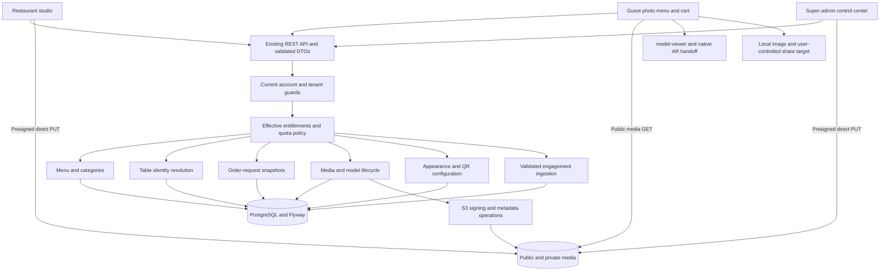

# System architecture proposal

Status: future architecture, preserving the modular monolith. [Index](README.md).

## Existing architecture

The application is a React 18/JavaScript SPA, Vite/Tailwind, custom History API routing and shared API/AuthContext, with Java 21/Spring Boot 3.3.5/Spring Security/JPA and shared-schema PostgreSQL/Flyway. S3 receives browser-uploaded bytes directly. Google model-viewer supplies 3D/AR. No evidence establishes deployed CloudFront; a public-base-URL hook is not provisioned infrastructure.

Source: [App](../frontend/src/App.jsx), [client](../frontend/src/api/client.js), [AuthContext](../frontend/src/context/AuthContext.jsx), [backend packages](../backend/src/main/java/com/atelier/media), [current architecture](../project-documentation/CODEBASE_ARCHITECTURE.md). Restaurant row currently also represents the owner login; separate platform users represent admins. Keep that account model until an explicitly approved staff/multiple-user need justifies change.

## Proposed boundaries

These are logical services within the existing deployable application, not new microservices. Reuse current controllers/services/repositories; introduce narrowly named policy, table, snapshot and model-version services where existing boundaries cannot express a domain safely. No broker, distributed cache, alternate renderer, framework/auth replacement or new external provider by default.

| Domain | Reuse | Smallest extension |
|---|---|---|
| Accounts/tenants | AuthService, AdminAuthService, RestaurantAccess, AdminAccess, JWT principals | Equivalent guards on new routes; coherent recovery/session lifecycle |
| Capabilities | Restaurant.canUpload3d, configuration limits, audit log | Code registry + immutable plan revisions + assignment + overrides + resolver |
| Quotas | Existing usage counters and restaurant locking | Explicit definitions/reservations and same-transaction enforcement |
| Menu | Media as photo-first dish, Category, PublicMenuService | Mode preference/effective public projection; no separate menu per mode |
| Tables/QR | Venue route and shared QR renderer | Tenant table rows, hashed opaque tokens and context resolution |
| Requests | Guest components/client | Browser cart + validated immutable server snapshot + bounded attempt observations |
| Models | DishService, ModelRequestService, S3Storage | Shared issued-upload validation, immutable versions and origin/actor lineage |
| Branding | Existing Restaurant/settings/assets | One versioned draft/published appearance row; validated QR design config |
| Analytics | Existing events/daily aggregates/counters | Explicit metric schema, atomic durable writes and trusted reporting cutover |
| Reviews | Existing contact settings/SocialBar | Separate validated review destination and toggle |

## Request and transaction contracts

Authenticated identity comes from verified principal, then current DB account state; route/body IDs identify targets, not authority. Guest route slug/table token resolve public context. Every service scopes related resources to the resolved restaurant. Public DTOs are allowlisted projections, distinct from staff/admin responses. Keep legacy public route and `/r/{slug}` stable.

Use short transactions for policy locks, reservation changes, ownership revalidation, assignments, counters and mandatory audit. External S3 HEAD/inspection/delete happens outside locks, then state is revalidated on commit. A durable cleanup record/outbox may be justified for deletion retries; do not assume an external queue. Optimistic versions protect forms/appearance, idempotency protects retried creates/confirmations. Network timeout means unknown outcome until authoritative read/replay, not permission to duplicate work.

Guest order image is rendered locally from a server-owned immutable snapshot, keeping image binaries out of the DB and avoiding a receipt hosting service. Sharing and AR handoffs remain browser/device interactions; backend capability policy cannot verify their eventual delivery/placement. Official message delivery would be a separately approved adapter and state evidence source.

## Caches, deployment and observability

Current Caffeine publication/throttle caches are instance-local. Initial plan assumes one backend instance only until deployment topology is verified. Mutation policy/quota checks read fresh versioned state; public projections need after-commit invalidation and expiry at override boundaries. Multi-instance rollout requires reviewed cross-node invalidation/version-aware read behavior and shared abuse budgets; do not silently add Redis. Public CDN/browser caches must follow the same capability freshness contract.

Measure guest payload/loading, DB query latency, event-ingestion failure/duplicates, quota denials, pending reservation expiry and cleanup failures. Correlation IDs and bounded structured logs exclude notes, tokens, signed URLs and credentials. Readiness includes operational recovery evidence, backup/restore rehearsal and additive schema compatibility; current hosting templates do not prove production operations work.

## Dependencies, decisions and acceptance

Depends on Phase 1, domain-specific specifications and approved schema defaults. Decide pinned revisions/legacy grants, request retention, S3 finalization, single-instance assumptions and slug aliases before implementation. Do not create unnecessary generalized workflow engines, CMS, e-commerce checkout, guest accounts or payment tables.

Acceptance: trace each domain from UI through DTO/policy/service/scoped repository to public projection. A/B tenant fixtures demonstrate isolation; concurrent final-slot/consume/aggregate tests use disposable PostgreSQL. Existing upload/replacement/public/preview/legacy behavior stays covered. Measure browser/device/operations separately and report unknown deployed integrations explicitly.
