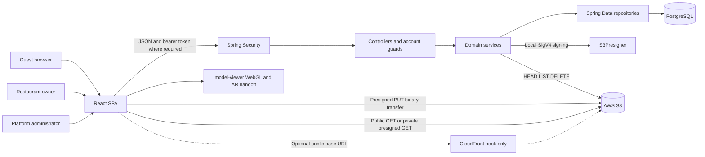
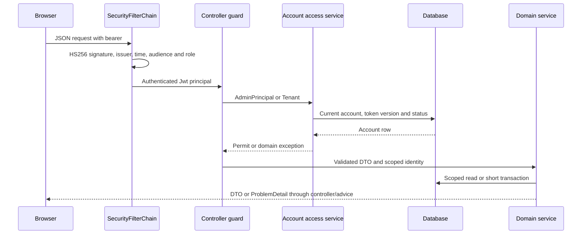
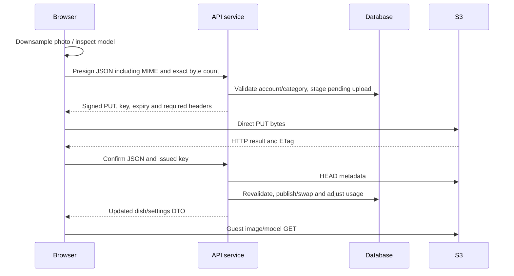
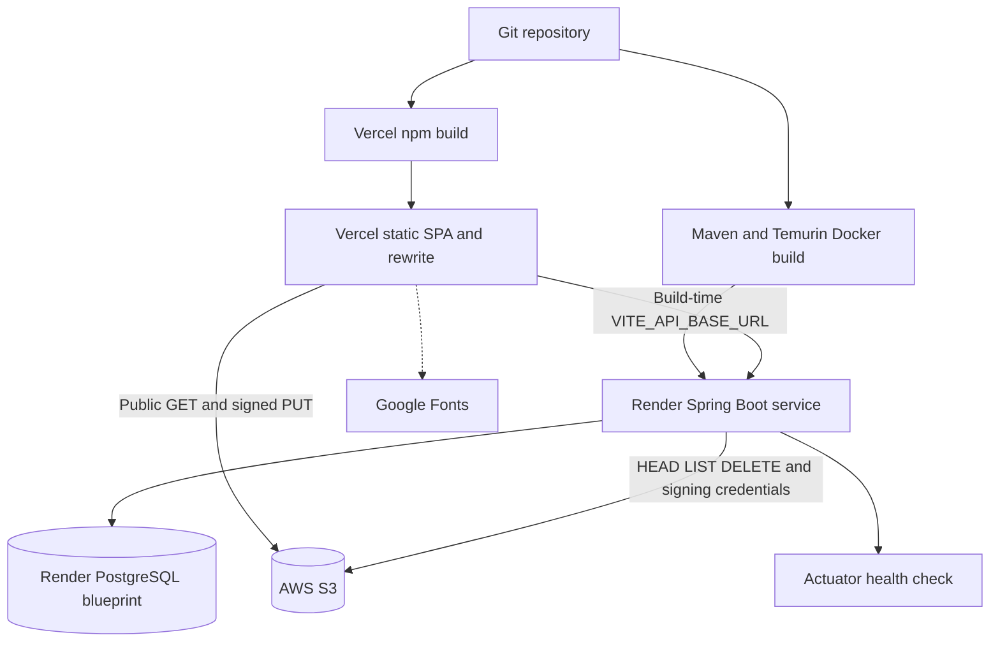

# Atelier AR codebase architecture

Snapshot: 2026-10-31, working tree over `330a49c`, including uncommitted A01–A03 fixes. [Master](MASTER_PROJECT_DOCUMENTATION.md) · [API](API_REFERENCE.md) · [Database](DATABASE_DOCUMENTATION.md).

## 1. System boundaries

Atelier AR is a React SPA and Spring Boot modular monolith with a shared-schema, application-scoped tenant model. PostgreSQL stores accounts, menu metadata, upload state and engagement; S3 stores bytes. There are no separately deployed domain microservices, message broker, payment integration, model conversion server or external identity provider in this repository.

The optional CDN edge is a URL substitution, not provisioned CloudFront infrastructure. The browser performs image processing and model inspection; claims of zero server RAM mean **no upload file buffering in application handlers**, not literally zero JVM memory use. HEAD verifies object metadata and cannot prove the file is a valid or safe GLB/image.

## 2. Repository and package organization

The opened workspace is the parent `atelier-3d-media-engine-v4`; Git/application root is its child `atelier-3d-media-engine`. Root contains the deployment templates, infra JSON, preserved historical documentation, and this new directory. `backend/` and `frontend/` are separate Maven/npm modules, not a unified root build. Current source inventory: 144 main Java files and 61 frontend source files. Appendix inventories below are derived from all those source files.

Backend packages under `backend/src/main/java/com/atelier/media/`:

| Package | Responsibilities and important types |
|---|---|
| root | `AtelierMediaApplication`: Spring Boot entry point |
| web | Eight application controllers; `GlobalExceptionHandler`; HTTP mapping/DTO validation and response cache policies |
| service | Auth/access gates, admin provisioning, menu/dish/category/branding, S3 adapter, concierge/history, analytics, cleanup, mapping/policies |
| repository | Ten Spring Data interfaces; scoped finders, explicit JPQL counters/aggregates, history filters and locks |
| model | Ten mapped entities, composite analytics identity and status/type enums; scalar FKs |
| dto / dto.admin | Request/response records, compatibility constructors, bean constraints and pagination serialization |
| security | `SecurityConfig`, `JwtKeys`, `TokenService`, `Tenant`, `AdminPrincipal`, login throttle and trusted-proxy resolver |
| config | Typed properties, AWS beans, profiles, cache, async/scheduling and cloud database URL adaptation |
| exception | Domain failures mapped to stable HTTP ProblemDetail titles/statuses |

Frontend `frontend/src/`: `main.jsx` mounts providers/application; `App.jsx` selects routes; `pages/` owns screens; `components/` groups admin/studio/guest/landing UI; `context/AuthContext.jsx` owns independent sessions; `api/client.js` centralizes HTTP; `utils/` handles navigation, media, upload sequencing, QR, theme and formatting. CSS/Tailwind are the existing design system.

## 3. Frontend architecture

### Routing and state

`utils/router.js` uses browser History, popstate and a custom navigation event through `useSyncExternalStore`. `/`, `/r/:slug`, `/studio`, `/admin` are the only screen routes; unknown paths render the existing not-found screen. Query parameters select studio tab, owner preview and dish deep links. There is no React Router dependency, SSR server or public restaurant directory. Production host rewrites route reloads to index.html.

AuthContext persists normal restaurant/admin sessions in localStorage; impersonation transfers through a one-time localStorage handoff into sessionStorage. It restores sessions, calls me endpoints, handles 401 logout and password-required 403 state. The API client keeps separate in-memory bearer values and never attaches them to public menu calls. Logout is local removal, not server-side revocation.

Page state uses hooks rather than Redux/query-library caches. Studio loads settings/dishes/categories; admin separately loads restaurant pages, analytics, current pipeline and history; guest loads a menu then filters/grouping locally. Settings reload on window focus reflects direct-model permission changes. Some failures are intentionally silent (analytics tracking, category preload); failed API actions generally use field errors/toasts.

### Important screens

| Screen | Components | Backend use | User actions and states |
|---|---|---|---|
| `pages/HomePage.jsx` | Landing showcase, table stand, FAQ, contact modal, Navbar/AuthModal | No persistent lead API; sign-in uses AuthContext | Explore demo, book via mailto/clipboard, staff sign-in. Showcase is illustrative content, not tenant menu data |
| `pages/StudioPage.jsx` | StudioTopBar, DishManager, NewDishStudio, BatchUploadStudio, BrandCustomizer, StudioAnalytics, CategoryManagerModal, password modals | studioDishes/settings/categories plus module actions | Locked setup state, tabs, load/retry errors, add/edit/replace/delete/availability, model permission-aware controls, live toggle and QR |
| `pages/AdminPage.jsx` | AdminLogin, KpiCards, RestaurantTable/FormModal/Drawer, DeleteRestaurantModal, TemporaryPasswordModal, Admin3dDeskModal, LuxurySelect | Admin list/search/pagination/analytics and 3D current/history | Provision/edit/status/restore/reset/impersonate/delete, notes, permissions, publish finished model; separate loading/error states |
| `pages/GuestMenuPage.jsx` | MenuHero, CategoryNav, GuestDishCard, FilterBar, DishSheet, SocialBar, ArHandoffModal | Public menu; owner preview uses studioMenuPreview; event tracking | Search/chef/AR filters, category navigation, dish details, 3D/AR launch, social/contact links, deep-link dish. Private holding-screen contract is currently mismatched (PD01) |

### Reuse, validation and visual behavior

`components/ui.jsx` supplies fields/buttons/overlays/spinners; Toast supplies notifications; LuxurySelect customizes selection. Tailwind classes, hairline borders, glass surfaces, onyx backgrounds, accent theme CSS variables and Cormorant/Manrope/JetBrains typography define the existing visual language. Theme choices are amber/emerald/gold/zinc; layout settings are cards/compact, currency is configurable. These are source-supported controls, not a completed visual/accessibility review.

Forms maintain local values, derive validity and render API field errors. Backend DTO validation remains authoritative. Blank optional branding fields are cleaned; URLs are constrained to HTTP(S) and maps allowlists. Dish tags are normalized against a fixed backend vocabulary. Browser format/size checks help usability but cannot be security controls. Responsive breakpoints, safe-area padding, bottom sheets, mobile nav and touch targets exist; no browser/device sweep was performed here.

`api/client.js.request` uses fetch/AbortController, JSON, a 15-second timeout, per-session bearer selection, `no-store` for authenticated calls, structured ApiError and session clearing on 401. XHR handles direct uploads, signed headers, ETag extraction, progress and ten-minute timeout. There is no generalized retry/offline queue, refresh-token renewal or persistent local mutation log.

### Media/UI performance

`utils/media.js` decodes/downsamples images progressively with Canvas, caps default dimensions at 1400, prefers WebP at quality .82 and falls back to JPEG. Logo defaults: 512/.88; banner: 1920/.84. This creates an optimized uploaded image, not a backend thumbnail derivative hierarchy. Object URLs support previews and are revoked by relevant components.

BatchUploadStudio caps a batch at 15 and uses three async upload workers; image processing is performed before upload. Individual failures remain UI concerns; no durable server batch entity exists. `inspectModel` inspects GLB header/JSON and self-contained glTF external-resource rules up to 50 MiB, estimates mesh statistics and reports compression extensions; it does not compress geometry or verify every binary asset.

ModelStage loads model-viewer dynamically and wires custom element events imperatively because React 18 does not forward them normally. DishSheet preloads the 3D stage when the dish is opened, cross-fades photo/3D, tracks interactions, and calls activateAR with handoff fallback. Thus “lazy” means the library is not needed until a stage mounts; landing showcase can also cause a stage to mount. Whole pages are still statically imported. Prior build sizes: main JS 579.61 kB, model-viewer chunk 1072.76 kB, CSS 63.69 kB before gzip; not remeasured here.

QR helpers produce a venue URL under `/r/{slug}`, a qrcode matrix, branded SVG and raster PNG; the print window supports browser print-to-PDF (no dedicated PDF generator). Font embedding fetches Google Fonts. ArHandoffModal produces a dish deep-link QR. No per-table tracking/configuration or persisted QR entity exists.

## 4. Backend module responsibilities

| Service/module | Internal responsibility and design boundary |
|---|---|
| AuthService | Normalize restaurant login, throttle/password verification, account/profile, replace password, issue setup/full tokens; support sessions cannot change owner password |
| AdminAuthService / AdminAccess | Separate admin login/password logic; shared current admin existence/version/role/usable-account check for every admin HTTP operation |
| RestaurantAccess | Current row/version/deletion/status checks; forced password change except impersonation; no stale token-version cache after A02 |
| AdminService | Tenant provisioning/lifecycle/notes/permissions/search/detail/usage reset, audited support impersonation, soft/hard deletion; uses short transactions and admin audit attribution |
| DishService | Tenant-scoped completed-dish CRUD, validated custom category, availability, staged attach/confirm/remove model, usage and menu invalidation; direct-model permission enforced |
| MediaService | Photo-first pending row, locked dish-code sequence, presign/HEAD/confirm and stale pending media cleanup |
| MediaReplacementService | Replace photo while preserving live asset until confirmation; model branch delegates to DishService |
| BrandingService | Studio settings and staged logo/banner presign/confirm/removal, HTTP URL validation, usage/cache updates |
| CategoryService | Flat category CRUD/reorder/default seed/deduplication; scoped ownership, but missing publication cache eviction/name uniqueness remains |
| PublicMenuService / DishMapper | Guest-safe completed/available menu and staff preview, active category maps, public status/live rules; staff and guest projections differ |
| ModelRequestService | One-to-five private reference photos and pending-key registry; locked confirm/history; final admin publication, supersession and approved reference cleanup |
| AnalyticsService | Public event validation/rate-limit/dedup, asynchronous counters/event/daily writes; studio/platform summaries; daily write races remain |
| S3Storage | Prefix/UUID/public URL, local PUT/GET signing, metadata HEAD, object/prefix deletion; no upload-byte buffering |
| StorageJanitor / StaleUploadReaper | Async public tenant cleanup; scheduled expired pending media and approved references; private lifecycle/retry gaps remain |
| OtpService / EmailSender | Optional hashed password reset and attempts; only LoggingEmailSender implementation exists; transactional lockout flaw remains |
| SuperAdminBootstrap | Activate seeded account, optional reset or generated password; no forced setup-role enforcement and bootstrap resets do not increment version |
| SlugPolicy / DietaryTags / MediaRules | Shared slug normalization/reservation, fixed tag vocabulary, MIME/extension/size/filename rules |

## 5. Security and request lifecycle

SecurityConfig remains the role/audience/default-deny boundary; controller `@ModelAttribute` methods add current-account validation on every AdminController/StudioController handler. AdminAuthService validates its two protected account methods directly; login is public. Media services retain RestaurantAccess. Service methods accepting scalar tenant IDs rely on their protected callers; do not expose them through new unguarded controllers. A01–A03 remediation is tested, not proof against every future endpoint.

## 6. Photo and model data flow

This ideal sequence is implemented for ordinary photos/direct models/replacements with HEAD outside DB transactions. Concierge confirmation and approval are exceptions: their transactional methods perform HEAD inside transactions. Admin final model signing does not persist a pending final key, unlike the owner direct-model track. Published keys have long immutable cache headers and public reads; menu-private mode does not revoke already-known URLs. Private references use separate prefix and presigned GET, but supplied policy/cache templates remain inconsistent.

## 7. Persistence, concurrency, async and caching

Flyway is schema owner; there are 13 migrations per vendor, ten tables and one shared tenant schema. Repositories generally use `...AndRestaurantId` filters; admin and internal jobs legitimately use unscoped queries. Media has optimistic versioning; sequence allocation and concierge confirmation use explicit pessimistic locks; usage counter updates are JPQL arithmetic. Restaurant itself lacks optimistic versioning. The database does not enforce composite category ownership; A03 is application validation.

Caffeine caches published menus by slug for ten minutes, max 5000 entries. Writes generally evict owning menus, except category changes. It is process-local; public responses add browser/CDN caching. Restaurant account access now reads current version every time. Login/analytics rate and dedup caches are process-local. Multi-instance deployments require an explicit consistency/abuse budget decision, not assumed shared caches.

AsyncConfig enables @Async for StorageJanitor using Boot's executor. SchedulingConfig conditionally enables scheduling; StaleUploadReaper runs fixed delay five minutes after an initial one minute, not an OS cron. AnalyticsService creates its own virtual-thread-per-task executor and ignores the returned CompletableFuture; it is separate from @Async cleanup. Persistent event delivery/backpressure/shutdown reliability is not implemented.

## 8. Deployment topology

This is the declared topology in render.yaml, Dockerfiles and Vercel JSON, not confirmation of deployed hosts. Both Dockerfiles skip tests; root Vercel uses npm install, not a lockfile-only npm ci workflow. No CI pipeline, container registry workflow, IaC CloudFront distribution, backup automation or centralized error/metrics service is configured in source. Local testing and safe operation are in [deployment/setup](DEPLOYMENT_AND_SETUP.md).

## 9. Complete frontend source index

Every source file is listed below. Export names and direct api calls were extracted from source; parent callbacks/shared helpers may perform additional calls. This index complements the screen/workflow explanations rather than treating an import as runtime verification.

|Source|Exports/component|Direct API operations|
|---|---|---|
|[frontend/src/App.jsx](../frontend/src/App.jsx)|App|None directly detected|
|[frontend/src/api/client.js](../frontend/src/api/client.js)|API_BASE, setAuthToken, setAdminToken, setUnauthorizedHandler, PASSWORD_CHANGE_REQUIRED, setPasswordRequiredHandler, ApiError, api, putToS3|None directly detected|
|[frontend/src/components/ArHandoffModal.jsx](../frontend/src/components/ArHandoffModal.jsx)|ArHandoffModal|None directly detected|
|[frontend/src/components/AuthModal.jsx](../frontend/src/components/AuthModal.jsx)|AuthModal|authConfig, forgotPassword, resetPasswordOtp|
|[frontend/src/components/ModelStage.jsx](../frontend/src/components/ModelStage.jsx)|AR_MODES, LIGHTING, ModelStage|None directly detected|
|[frontend/src/components/Navbar.jsx](../frontend/src/components/Navbar.jsx)|Navbar|None directly detected|
|[frontend/src/components/RestaurantQrModal.jsx](../frontend/src/components/RestaurantQrModal.jsx)|RestaurantQrModal|None directly detected|
|[frontend/src/components/Toast.jsx](../frontend/src/components/Toast.jsx)|ToastProvider, useToast|None directly detected|
|[frontend/src/components/admin/Admin3dDeskModal.jsx](../frontend/src/components/admin/Admin3dDeskModal.jsx)|Admin3dDeskModal|adminPresignModel, adminApproveModel|
|[frontend/src/components/admin/AdminLogin.jsx](../frontend/src/components/admin/AdminLogin.jsx)|AdminLogin|None directly detected|
|[frontend/src/components/admin/ChangePasswordModal.jsx](../frontend/src/components/admin/ChangePasswordModal.jsx)|ChangePasswordModal|adminChangePassword|
|[frontend/src/components/admin/DeleteRestaurantModal.jsx](../frontend/src/components/admin/DeleteRestaurantModal.jsx)|DeleteRestaurantModal|adminDeleteRestaurant|
|[frontend/src/components/admin/KpiCards.jsx](../frontend/src/components/admin/KpiCards.jsx)|KpiCards|None directly detected|
|[frontend/src/components/admin/RestaurantDrawer.jsx](../frontend/src/components/admin/RestaurantDrawer.jsx)|RestaurantDrawer|adminResetPassword, adminRestaurant, adminRestaurantModelRequests, adminUpdateNotes, adminUpdate3dPermission, adminRestore, adminRecalculate|
|[frontend/src/components/admin/RestaurantFormModal.jsx](../frontend/src/components/admin/RestaurantFormModal.jsx)|RestaurantFormModal|adminSlugAvailable, adminUpdateRestaurant, adminCreateRestaurant|
|[frontend/src/components/admin/RestaurantTable.jsx](../frontend/src/components/admin/RestaurantTable.jsx)|RestaurantTable|None directly detected|
|[frontend/src/components/admin/TemporaryPasswordModal.jsx](../frontend/src/components/admin/TemporaryPasswordModal.jsx)|TemporaryPasswordModal|None directly detected|
|[frontend/src/components/admin/impersonate.js](../frontend/src/components/admin/impersonate.js)|impersonateRestaurant|adminImpersonate|
|[frontend/src/components/guest/CategoryNav.jsx](../frontend/src/components/guest/CategoryNav.jsx)|CategoryNav|None directly detected|
|[frontend/src/components/guest/DishSheet.jsx](../frontend/src/components/guest/DishSheet.jsx)|DishSheet|trackEvent|
|[frontend/src/components/guest/FilterBar.jsx](../frontend/src/components/guest/FilterBar.jsx)|FilterBar|None directly detected|
|[frontend/src/components/guest/GuestDishCard.jsx](../frontend/src/components/guest/GuestDishCard.jsx)|isChefSpecial, ArBadge, GuestDishCard, Pill|None directly detected|
|[frontend/src/components/guest/MenuHero.jsx](../frontend/src/components/guest/MenuHero.jsx)|MenuHero|None directly detected|
|[frontend/src/components/guest/SocialBar.jsx](../frontend/src/components/guest/SocialBar.jsx)|socialLinks, SocialBar|None directly detected|
|[frontend/src/components/guest/SocialGlyphs.jsx](../frontend/src/components/guest/SocialGlyphs.jsx)|InstagramGlyph, TikTokGlyph, WhatsAppGlyph, FacebookGlyph|None directly detected|
|[frontend/src/components/landing/ContactModal.jsx](../frontend/src/components/landing/ContactModal.jsx)|SALES_EMAIL, ContactModal|None directly detected|
|[frontend/src/components/landing/ShowcaseViewer.jsx](../frontend/src/components/landing/ShowcaseViewer.jsx)|ShowcaseViewer|None directly detected|
|[frontend/src/components/landing/TableStandMockup.jsx](../frontend/src/components/landing/TableStandMockup.jsx)|TableStandMockup|None directly detected|
|[frontend/src/components/studio/BatchUploadStudio.jsx](../frontend/src/components/studio/BatchUploadStudio.jsx)|BatchUploadStudio|None directly detected|
|[frontend/src/components/studio/BrandCustomizer.jsx](../frontend/src/components/studio/BrandCustomizer.jsx)|BrandCustomizer|updateSettings|
|[frontend/src/components/studio/CategoryManagerModal.jsx](../frontend/src/components/studio/CategoryManagerModal.jsx)|CategoryManagerModal|createCategory, updateCategory, deleteCategory, reorderCategories|
|[frontend/src/components/studio/DishEditModal.jsx](../frontend/src/components/studio/DishEditModal.jsx)|DishEditModal|updateDish|
|[frontend/src/components/studio/DishFields.jsx](../frontend/src/components/studio/DishFields.jsx)|DishFields, Toggle, dishToForm, formIsValid|None directly detected|
|[frontend/src/components/studio/DishManager.jsx](../frontend/src/components/studio/DishManager.jsx)|DishManager|setAvailability, deleteDish|
|[frontend/src/components/studio/ModelModal.jsx](../frontend/src/components/studio/ModelModal.jsx)|ModelModal|removeModel|
|[frontend/src/components/studio/ModelPicker.jsx](../frontend/src/components/studio/ModelPicker.jsx)|ModelPicker|None directly detected|
|[frontend/src/components/studio/NewDishStudio.jsx](../frontend/src/components/studio/NewDishStudio.jsx)|NewDishStudio|None directly detected|
|[frontend/src/components/studio/PhotoPicker.jsx](../frontend/src/components/studio/PhotoPicker.jsx)|PhotoPicker|None directly detected|
|[frontend/src/components/studio/PipelineView.jsx](../frontend/src/components/studio/PipelineView.jsx)|PipelineView, makeStages, overallProgress|None directly detected|
|[frontend/src/components/studio/Request3dModal.jsx](../frontend/src/components/studio/Request3dModal.jsx)|Request3dModal|presignModelRequest, confirmModelRequest|
|[frontend/src/components/studio/SetPasswordModal.jsx](../frontend/src/components/studio/SetPasswordModal.jsx)|SetPasswordModal|None directly detected|
|[frontend/src/components/studio/StudioAnalytics.jsx](../frontend/src/components/studio/StudioAnalytics.jsx)|StudioAnalytics|studioAnalytics|
|[frontend/src/components/studio/StudioChangePasswordModal.jsx](../frontend/src/components/studio/StudioChangePasswordModal.jsx)|StudioChangePasswordModal|changePassword|
|[frontend/src/components/studio/StudioTopBar.jsx](../frontend/src/components/studio/StudioTopBar.jsx)|StudioTopBar|setMenuStatus|
|[frontend/src/components/studio/VisualAssetReplacer.jsx](../frontend/src/components/studio/VisualAssetReplacer.jsx)|VisualAssetReplacer|None directly detected|
|[frontend/src/components/ui.jsx](../frontend/src/components/ui.jsx)|Badge, IconButton, Overlay, Field, inputClass, primaryButtonClass, Spinner|None directly detected|
|[frontend/src/components/ui/LuxurySelect.jsx](../frontend/src/components/ui/LuxurySelect.jsx)|LuxurySelect|None directly detected|
|[frontend/src/context/AuthContext.jsx](../frontend/src/context/AuthContext.jsx)|stashImpersonationHandoff, AuthProvider, useAuth|me, adminMe, login, changePassword, adminLogin|
|[frontend/src/index.css](../frontend/src/index.css)|Styles/provider/entry module; see source|None directly detected|
|[frontend/src/main.jsx](../frontend/src/main.jsx)|Styles/provider/entry module; see source|None directly detected|
|[frontend/src/pages/AdminPage.jsx](../frontend/src/pages/AdminPage.jsx)|AdminPage|analytics, adminRestaurants, admin3dRequests, admin3dRequestsHistory, adminSetStatus, adminRestore|
|[frontend/src/pages/GuestMenuPage.jsx](../frontend/src/pages/GuestMenuPage.jsx)|GuestMenuPage|studioMenuPreview, publicMenu, trackEvent|
|[frontend/src/pages/HomePage.jsx](../frontend/src/pages/HomePage.jsx)|HomePage|None directly detected|
|[frontend/src/pages/StudioPage.jsx](../frontend/src/pages/StudioPage.jsx)|StudioPage|settings, studioDishes, categories|
|[frontend/src/utils/format.js](../frontend/src/utils/format.js)|DEFAULT_CURRENCY, CATEGORY_ORDER, CATEGORY_LABEL, DIETARY, DIETARY_LABEL, STATUS_STYLE, cx, buzz, fmtBytes, fmtPrice, fmtCountdown, fmtDate, slugify, whatsappLink, safeHttpUrl|None directly detected|
|[frontend/src/utils/media.js](../frontend/src/utils/media.js)|MAX_IMAGE_DIM, IMAGE_QUALITY, MAX_MODEL_BYTES, MAX_FILENAME_BASE, sanitizeFilename, prettifyName, savedPercent, downsampleImage, inspectModel, LOGO_OPTIONS, BANNER_OPTIONS|None directly detected|
|[frontend/src/utils/modelViewer.js](../frontend/src/utils/modelViewer.js)|loadModelViewer, preloadModelViewer|None directly detected|
|[frontend/src/utils/qrCard.js](../frontend/src/utils/qrCard.js)|QR_THEMES, QR_FORMATS, QR_TAGLINE, menuUrl, buildQrMatrix, escapeXml, qrCardSvg, embeddedFontCss, downloadBlob, svgToPng, printCard|None directly detected|
|[frontend/src/utils/router.js](../frontend/src/utils/router.js)|navigate, useLocation, matchRoute, linkProps|None directly detected|
|[frontend/src/utils/theme.js](../frontend/src/utils/theme.js)|ACCENTS, accentStyle, CURRENCIES|None directly detected|
|[frontend/src/utils/upload.js](../frontend/src/utils/upload.js)|presignTtlSeconds, uploadDishPhoto, attachModel, uploadBrandingImage, replaceDishAsset|presign, confirm, attach3d, confirm3d, brandingPresign, brandingConfirm, replacePresign, replaceConfirm|

## 10. Backend service/config/security/repository method index

All files in these packages are indexed by declared method names; overloads collapse to one name. Entity and DTO fields are fully cataloged in the database and API references. Constructors/private helper names are included where detected, but this is not a public Java API promise.

|Source|Declared methods/constructors|
|---|---|
|[backend/src/main/java/com/atelier/media/service/AdminAccess.java](../backend/src/main/java/com/atelier/media/service/AdminAccess.java)|AdminAccess, requireAccount, InvalidTokenException|
|[backend/src/main/java/com/atelier/media/service/AdminAuthService.java](../backend/src/main/java/com/atelier/media/service/AdminAuthService.java)|AdminAuthService, login, InvalidCredentialsException, AdminAuthResponseDto, me, changePassword, InvalidFieldException|
|[backend/src/main/java/com/atelier/media/service/AdminService.java](../backend/src/main/java/com/atelier/media/service/AdminService.java)|AdminService, this, analytics, PlatformAnalyticsDto, list, detail, AdminRestaurantDetailDto, create, ConflictException, audit, AdminRestaurantCreatedDto, resetOwnerPassword, TemporaryPasswordDto, slugAvailability, SlugAvailabilityDto, update, updateNotes, update3dPermission, updateStatus, softDelete, restore, HardDeleteResult, hardDelete, recalculateUsage, impersonate, AuthResponseDto, require, resolveSlug, InvalidFieldException, temporaryPassword, asLong, nz|
|[backend/src/main/java/com/atelier/media/service/AnalyticsService.java](../backend/src/main/java/com/atelier/media/service/AnalyticsService.java)|AnalyticsService, this, recordEvent, InvalidFieldException, TooManyAttemptsException, persistEvent, getStudioAnalytics, StudioAnalyticsDto, getPlatformAnalytics, PlatformAnalyticsDto|
|[backend/src/main/java/com/atelier/media/service/AuthService.java](../backend/src/main/java/com/atelier/media/service/AuthService.java)|AuthService, login, InvalidCredentialsException, AccountSuspendedException, authResponse, me, changePassword, InvalidFieldException, AuthResponseDto, normalizeEmail|
|[backend/src/main/java/com/atelier/media/service/BrandingService.java](../backend/src/main/java/com/atelier/media/service/BrandingService.java)|parse, MediaNotFoundException, fileNamePrefix, BrandingService, getSettings, updateSettings, presignAsset, PresignResponseDto, confirmAsset, UploadVerificationException, clean, requireHttpUrl, InvalidMediaException|
|[backend/src/main/java/com/atelier/media/service/CategoryService.java](../backend/src/main/java/com/atelier/media/service/CategoryService.java)|CategoryService, getCategories, seedDefaultsIfEmpty, getActiveCategories, createCategory, ConflictException, updateCategory, deleteCategory, reorderCategories|
|[backend/src/main/java/com/atelier/media/service/DietaryTags.java](../backend/src/main/java/com/atelier/media/service/DietaryTags.java)|DietaryTags, normalize, InvalidFieldException, toColumn, fromColumn|
|[backend/src/main/java/com/atelier/media/service/DishMapper.java](../backend/src/main/java/com/atelier/media/service/DishMapper.java)|DishMapper, toDto, MediaResponseDto, toGuestDto|
|[backend/src/main/java/com/atelier/media/service/DishService.java](../backend/src/main/java/com/atelier/media/service/DishService.java)|DishService, this, listDishes, updateDish, setAvailability, deleteDish, requestModelUpload, ConflictException, PresignResponseDto, confirmModelUpload, UploadVerificationException, clearPending, removeModel, allocateNextDishCode, requireCompletedDish, notFound, MediaNotFoundException|
|[backend/src/main/java/com/atelier/media/service/EmailSender.java](../backend/src/main/java/com/atelier/media/service/EmailSender.java)|sendPasswordResetOtp|
|[backend/src/main/java/com/atelier/media/service/LoggingEmailSender.java](../backend/src/main/java/com/atelier/media/service/LoggingEmailSender.java)|LoggingEmailSender, sendPasswordResetOtp|
|[backend/src/main/java/com/atelier/media/service/LoginAttemptService.java](../backend/src/main/java/com/atelier/media/service/LoginAttemptService.java)|LoginAttemptService, super|
|[backend/src/main/java/com/atelier/media/service/MediaReplacementService.java](../backend/src/main/java/com/atelier/media/service/MediaReplacementService.java)|MediaReplacementService, presign, PresignResponseDto, confirm, UploadVerificationException, discardPending, requireCompletedDish, notFound, MediaNotFoundException|
|[backend/src/main/java/com/atelier/media/service/MediaRules.java](../backend/src/main/java/com/atelier/media/service/MediaRules.java)|MediaRules, normalizeContentType, requireImage, InvalidMediaException, requireModel, requireCompatibleExtension, requireMaxSize, sanitizeFilename, humanBytes|
|[backend/src/main/java/com/atelier/media/service/MediaService.java](../backend/src/main/java/com/atelier/media/service/MediaService.java)|MediaService, generatePresignedUploadUrl, InvalidMediaException, PresignResponseDto, confirmUpload, UploadVerificationException, markFailed, StoredObject, expireStalePresignedUploads, blankToNull, stripQuotes|
|[backend/src/main/java/com/atelier/media/service/MenuCache.java](../backend/src/main/java/com/atelier/media/service/MenuCache.java)|MenuCache, evict|
|[backend/src/main/java/com/atelier/media/service/ModelRequestService.java](../backend/src/main/java/com/atelier/media/service/ModelRequestService.java)|ModelRequestService, normalizeSlot, presignPhotos, InvalidMediaException, ConflictException, confirmRequest, getPendingRequests, presignModelUpload, PresignResponseDto, approveModel, afterCommit, getHistoryForRestaurant, getAllHistory, presignReferencePhotosJson, cleanupReferencePhotos, parsePhotos, resolveCategoryName|
|[backend/src/main/java/com/atelier/media/service/OtpService.java](../backend/src/main/java/com/atelier/media/service/OtpService.java)|OtpService, sendPasswordResetOtp, ResponseStatusException, MessageResponseDto, resetPasswordWithOtp, InvalidFieldException|
|[backend/src/main/java/com/atelier/media/service/PublicMenuService.java](../backend/src/main/java/com/atelier/media/service/PublicMenuService.java)|PublicMenuService, this, getMenu, PublicMenuDto, getStaffPreview, buildStaffPreview|
|[backend/src/main/java/com/atelier/media/service/RestaurantAccess.java](../backend/src/main/java/com/atelier/media/service/RestaurantAccess.java)|RestaurantAccess, requireStudioAccess, PasswordChangeRequiredException, requireAccount, InvalidTokenException, AccountSuspendedException|
|[backend/src/main/java/com/atelier/media/service/S3Storage.java](../backend/src/main/java/com/atelier/media/service/S3Storage.java)|S3Storage, PresignedUpload, requireConfigured, StorageNotConfiguredException, bucket, tenantPrefix, privateTenantPrefix, newKey, publicUrl, presignGet, presignPut, head, notUploaded, deleteQuietly, deleteKeys, deletePrefix, browserSettableHeaders, trimSlashes|
|[backend/src/main/java/com/atelier/media/service/SlugPolicy.java](../backend/src/main/java/com/atelier/media/service/SlugPolicy.java)|SlugPolicy, normalize, problem, isWellFormed, isReserved|
|[backend/src/main/java/com/atelier/media/service/StaleUploadReaper.java](../backend/src/main/java/com/atelier/media/service/StaleUploadReaper.java)|reap|
|[backend/src/main/java/com/atelier/media/service/StorageJanitor.java](../backend/src/main/java/com/atelier/media/service/StorageJanitor.java)|StorageJanitor, wipeRestaurantAssets|
|[backend/src/main/java/com/atelier/media/service/SuperAdminBootstrap.java](../backend/src/main/java/com/atelier/media/service/SuperAdminBootstrap.java)|SuperAdminBootstrap, run, bootstrap, randomPassword|
|[backend/src/main/java/com/atelier/media/config/AsyncConfig.java](../backend/src/main/java/com/atelier/media/config/AsyncConfig.java)|Configuration/record fields or marker; see source|
|[backend/src/main/java/com/atelier/media/config/AtelierProperties.java](../backend/src/main/java/com/atelier/media/config/AtelierProperties.java)|PasswordReset, Jwt, Cors, Login, SuperAdmin|
|[backend/src/main/java/com/atelier/media/config/AwsConfig.java](../backend/src/main/java/com/atelier/media/config/AwsConfig.java)|awsCredentialsProvider, s3Presigner, s3Client|
|[backend/src/main/java/com/atelier/media/config/AwsProperties.java](../backend/src/main/java/com/atelier/media/config/AwsProperties.java)|AwsProperties, S3, hasStaticCredentials, isBucketConfigured|
|[backend/src/main/java/com/atelier/media/config/CacheConfig.java](../backend/src/main/java/com/atelier/media/config/CacheConfig.java)|cacheManager|
|[backend/src/main/java/com/atelier/media/config/DatabaseUrlEnvironmentPostProcessor.java](../backend/src/main/java/com/atelier/media/config/DatabaseUrlEnvironmentPostProcessor.java)|getOrder, postProcessEnvironment|
|[backend/src/main/java/com/atelier/media/config/SchedulingConfig.java](../backend/src/main/java/com/atelier/media/config/SchedulingConfig.java)|Configuration/record fields or marker; see source|
|[backend/src/main/java/com/atelier/media/config/StartupProfileValidator.java](../backend/src/main/java/com/atelier/media/config/StartupProfileValidator.java)|StartupProfileValidator, validate, IllegalStateException, run, isProfileActive, isSet, get|
|[backend/src/main/java/com/atelier/media/security/AdminPrincipal.java](../backend/src/main/java/com/atelier/media/security/AdminPrincipal.java)|AdminPrincipal, this, from, InvalidTokenException|
|[backend/src/main/java/com/atelier/media/security/CaffeineLoginThrottle.java](../backend/src/main/java/com/atelier/media/security/CaffeineLoginThrottle.java)|CaffeineLoginThrottle, checkAllowed, TooManyAttemptsException, recordFailure, applyProgressiveDelay, recordSuccess, compositeKey|
|[backend/src/main/java/com/atelier/media/security/ClientIpResolver.java](../backend/src/main/java/com/atelier/media/security/ClientIpResolver.java)|ClientIpResolver, resolveClientIp|
|[backend/src/main/java/com/atelier/media/security/JwtKeys.java](../backend/src/main/java/com/atelier/media/security/JwtKeys.java)|JwtKeys, secretKey, IllegalStateException, SecretKeySpec, encoder, NimbusJwtEncoder, decoder|
|[backend/src/main/java/com/atelier/media/security/LoginThrottle.java](../backend/src/main/java/com/atelier/media/security/LoginThrottle.java)|checkAllowed, recordFailure, recordSuccess|
|[backend/src/main/java/com/atelier/media/security/SecurityConfig.java](../backend/src/main/java/com/atelier/media/security/SecurityConfig.java)|securityFilterChain, writeProblem, doFilterInternal, jwtSecretKey, jwtEncoder, jwtDecoder, passwordEncoder, BCryptPasswordEncoder, clock, corsConfigurationSource|
|[backend/src/main/java/com/atelier/media/security/Tenant.java](../backend/src/main/java/com/atelier/media/security/Tenant.java)|Tenant, this, from, InvalidTokenException|
|[backend/src/main/java/com/atelier/media/security/TokenService.java](../backend/src/main/java/com/atelier/media/security/TokenService.java)|TokenService, IssuedToken, issue, restaurantToken, issueImpersonation, issueAdmin, encode|
|[backend/src/main/java/com/atelier/media/repository/AdminAuditLogRepository.java](../backend/src/main/java/com/atelier/media/repository/AdminAuditLogRepository.java)|findByRestaurantIdOrderByCreatedAtDesc|
|[backend/src/main/java/com/atelier/media/repository/AnalyticsDailyRepository.java](../backend/src/main/java/com/atelier/media/repository/AnalyticsDailyRepository.java)|findByRestaurantIdAndDayBetween|
|[backend/src/main/java/com/atelier/media/repository/AnalyticsEventRepository.java](../backend/src/main/java/com/atelier/media/repository/AnalyticsEventRepository.java)|countByRestaurantIdAndEventType, countByEventType, findTopDishesByRestaurantId, countEventsSince|
|[backend/src/main/java/com/atelier/media/repository/CategoryRepository.java](../backend/src/main/java/com/atelier/media/repository/CategoryRepository.java)|findByRestaurantIdOrderByDisplayOrderAscIdAsc, findByRestaurantIdAndIsActiveTrueOrderByDisplayOrderAscIdAsc, findByIdAndRestaurantId, existsByRestaurantIdAndNameIgnoreCase, countByRestaurantId|
|[backend/src/main/java/com/atelier/media/repository/MediaRepository.java](../backend/src/main/java/com/atelier/media/repository/MediaRepository.java)|findByIdAndRestaurantId, findByIdAndRestaurantIdForUpdate, findByS3KeyAndRestaurantId, findByRestaurantIdAndUploadStatusOrderByCreatedAtDesc, findByRestaurantIdAndUploadStatusAndAvailableTrueOrderByCreatedAtDesc, findByRestaurantIdAndMediaTypeAndUploadStatus, findByRestaurantIdAndDishCategoryAndUploadStatus, findByRestaurantId, countByRestaurantIdAndUploadStatus, countByRestaurantId, existsByRestaurantIdAndDishCode, findByRestaurantIdAndDishCode, countByRestaurantIdAndUploadStatusAndModelS3KeyIsNotNull, coalesce, findByS3Key, findByUploadStatusOrderByCreatedAtDesc, findByMediaTypeAndUploadStatus, findByDishCategoryAndUploadStatus, findTop200ByUploadStatusAndCreatedAtBefore, findTop200ByPendingModelS3KeyIsNotNullAndPendingModelCreatedAtBefore, findTop200ByPendingImageS3KeyIsNotNullAndPendingImageCreatedAtBefore, findByModelRequestStatusOrderByModelRequestedAtDesc, countByModelRequestStatus, findTop5ByRestaurantIdAndUploadStatusOrderByViewsCountDesc, findByModelRequestStatusAndModelCompletedAtBefore, incrementViews, incrementModelViews, incrementArLaunches|
|[backend/src/main/java/com/atelier/media/repository/ModelRequestPendingKeyRepository.java](../backend/src/main/java/com/atelier/media/repository/ModelRequestPendingKeyRepository.java)|findByRestaurantIdAndDishId, deleteByDishId, deleteByCreatedAtBefore|
|[backend/src/main/java/com/atelier/media/repository/ModelRequestRepository.java](../backend/src/main/java/com/atelier/media/repository/ModelRequestRepository.java)|findByRestaurantIdOrderByRequestedAtDesc, findByDishIdOrderByRequestedAtDesc, findFirstByDishIdAndStatusIn, findFirstByDishIdAndStatusOrderByRequestedAtDesc, findByStatusOrderByRequestedAtDesc, findAllByOrderByRequestedAtDesc, WHERE|
|[backend/src/main/java/com/atelier/media/repository/PasswordResetOtpRepository.java](../backend/src/main/java/com/atelier/media/repository/PasswordResetOtpRepository.java)|findTopByEmailAndUsedFalseAndExpiresAtAfterOrderByCreatedAtDesc, invalidateExistingOtps|
|[backend/src/main/java/com/atelier/media/repository/PlatformUserRepository.java](../backend/src/main/java/com/atelier/media/repository/PlatformUserRepository.java)|findByEmail, findByRole|
|[backend/src/main/java/com/atelier/media/repository/RestaurantRepository.java](../backend/src/main/java/com/atelier/media/repository/RestaurantRepository.java)|findByIdForUpdate, findBySlug, findByEmail, existsBySlug, existsByEmail, existsBySlugAndIdNot, existsByEmailAndIdNot, countByDeletedAtIsNull, countByStatusAndDeletedAtIsNull, totalStorageBytes, totalDishes, totalModels, findTop5ByDeletedAtIsNullOrderByStorageUsedBytesDesc, findTop5ByDeletedAtIsNullOrderByDishCountDesc, adjustUsage, setUsage, incrementMenuViews, incrementModelViews, incrementArLaunches|
