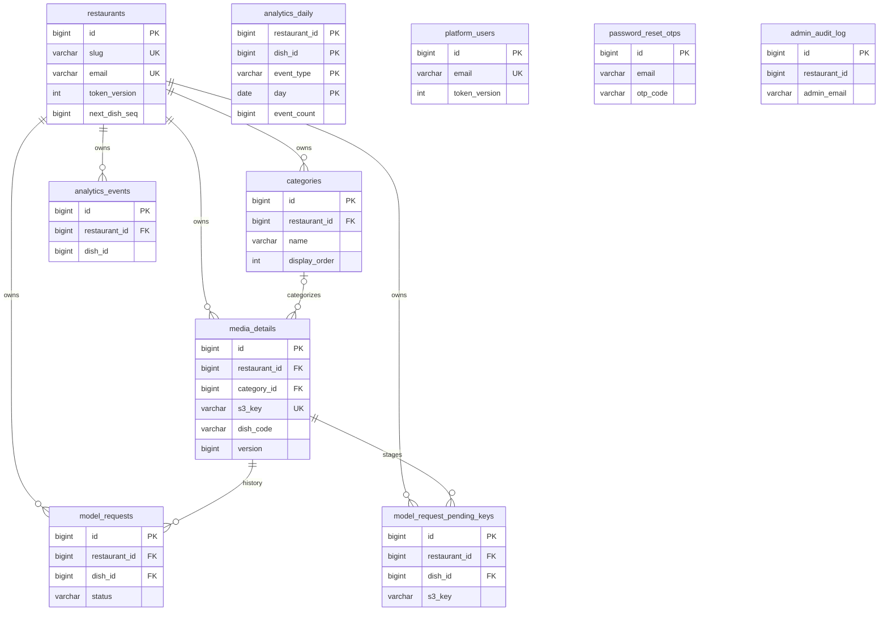

# Database documentation

Snapshot: 2026-10-31. PostgreSQL is the deployment datasource; H2 is the local/test alternative. Dictionary reconstructed in numeric migration order from actual PostgreSQL V1–V13, cross-referenced to JPA entities. This is a **declared schema**, not inspection of a live database.

[Master](MASTER_PROJECT_DOCUMENTATION.md) · [API DTOs](API_REFERENCE.md#dto-field-and-validation-catalog) · [Security](SECURITY_DOCUMENTATION.md)

## Configuration and ownership

`backend/src/main/resources/application.yml` enables Flyway at `classpath:db/migration/{vendor}`, baseline-on-migrate=true, Hibernate ddl-auto=none, open-in-view=false and UTC JDBC timestamps. Pool maximum defaults to ten, minimum two, connection timeout five seconds, autocommit false; local profile reduces pool to five/minimum one. Default profile is prod. Local+h2 writes a file database under backend/data; test profile uses in-memory H2 with PostgreSQL compatibility. No production schema/connection was inspected.

JPA uses scalar IDs for most relationships, not bidirectional entity graphs; SQL owns FK/cascade semantics. No separate user-to-restaurant membership, menu, subcategory, subscription, payment or table-order table exists. The owner account is embedded in restaurants; platform_users is separate.

## ER diagram

Solid relationships below represent declared SQL FKs. Analytics dish IDs, audit restaurant IDs, OTP email and analytics_daily tenant/dish IDs are logical references without FK constraints.



## Complete field dictionary

SQL definitions include lengths/precision, defaults, nullability and inline checks/references. Named/table constraints are cataloged in the migration ledger, rather than incorrectly attributing them to one field. Password/hash/code field names are necessary schema metadata; no stored values are shown.

### media_details

|Column|PostgreSQL definition after migrations|Introduced by|Later notes|
|---|---|---|---|
|`id`|`BIGSERIAL PRIMARY KEY`|V1__create_media_details.sql|—|
|`original_file_name`|`VARCHAR(255) NOT NULL`|V1__create_media_details.sql|—|
|`stored_file_name`|`VARCHAR(120) NOT NULL`|V1__create_media_details.sql|—|
|`s3_bucket`|`VARCHAR(63) NOT NULL`|V1__create_media_details.sql|—|
|`s3_key`|`VARCHAR(512) NOT NULL`|V1__create_media_details.sql|—|
|`s3_url`|`VARCHAR(1024) NOT NULL`|V1__create_media_details.sql|—|
|`content_type`|`VARCHAR(64) NOT NULL`|V1__create_media_details.sql|—|
|`file_extension`|`VARCHAR(10) NOT NULL`|V1__create_media_details.sql|—|
|`file_size_bytes`|`BIGINT NOT NULL CHECK (file_size_bytes > 0)`|V1__create_media_details.sql|—|
|`original_size_bytes`|`BIGINT CHECK (original_size_bytes IS NULL OR original_size_bytes > 0)`|V1__create_media_details.sql|—|
|`media_type`|`VARCHAR(20) NOT NULL CHECK (media_type IN ('IMAGE_2D', 'MODEL_3D', 'DAILY_SPECIAL'))`|V1__create_media_details.sql|—|
|`upload_status`|`VARCHAR(20) NOT NULL DEFAULT 'PRESIGNED' CHECK (upload_status IN ('PRESIGNED', 'COMPLETED', 'FAILED'))`|V1__create_media_details.sql|—|
|`dish_title`|`VARCHAR(160) NOT NULL`|V1__create_media_details.sql|—|
|`price_tag`|`NUMERIC(10, 2) NOT NULL CHECK (price_tag >= 0)`|V1__create_media_details.sql|—|
|`dish_category`|`VARCHAR(20) NOT NULL; current named CHECK allows STARTERS, MAINS, DESSERTS, CHEF_SPECIALS, DRINKS`|V1__create_media_details.sql|V3 replaces original inline four-category check; see ck_media_details_dish_category in ledger|
|`has_ar_support`|`BOOLEAN NOT NULL DEFAULT FALSE`|V1__create_media_details.sql|—|
|`ar_placement`|`VARCHAR(10) NOT NULL DEFAULT 'table' CHECK (ar_placement IN ('table', 'floor'))`|V1__create_media_details.sql|—|
|`width_px`|`INTEGER CHECK (width_px IS NULL OR width_px > 0)`|V1__create_media_details.sql|—|
|`height_px`|`INTEGER CHECK (height_px IS NULL OR height_px > 0)`|V1__create_media_details.sql|—|
|`etag`|`VARCHAR(128)`|V1__create_media_details.sql|—|
|`uploaded_by_user_id`|`VARCHAR(64)`|V1__create_media_details.sql|—|
|`created_at`|`TIMESTAMPTZ NOT NULL DEFAULT NOW()`|V1__create_media_details.sql|—|
|`completed_at`|`TIMESTAMPTZ`|V1__create_media_details.sql|—|
|`restaurant_id`|`BIGINT NOT NULL`|V2__multi_tenant_auth.sql|—|
|`version`|`BIGINT NOT NULL DEFAULT 0`|V2__multi_tenant_auth.sql|—|
|`model_s3_key`|`VARCHAR(500)`|V3__super_admin_and_branding.sql|—|
|`model_s3_url`|`TEXT`|V3__super_admin_and_branding.sql|—|
|`model_file_size_bytes`|`BIGINT NOT NULL DEFAULT 0`|V3__super_admin_and_branding.sql|—|
|`pending_model_s3_key`|`VARCHAR(500)`|V3__super_admin_and_branding.sql|—|
|`pending_model_size_bytes`|`BIGINT`|V3__super_admin_and_branding.sql|—|
|`pending_model_content_type`|`VARCHAR(64)`|V3__super_admin_and_branding.sql|—|
|`pending_model_created_at`|`TIMESTAMPTZ`|V3__super_admin_and_branding.sql|—|
|`is_available`|`BOOLEAN NOT NULL DEFAULT TRUE`|V3__super_admin_and_branding.sql|—|
|`description`|`TEXT`|V3__super_admin_and_branding.sql|—|
|`dietary_tags`|`VARCHAR(255)`|V3__super_admin_and_branding.sql|—|
|`pending_image_s3_key`|`VARCHAR(512)`|V4__restaurant_provisioning.sql|—|
|`pending_image_size_bytes`|`BIGINT`|V4__restaurant_provisioning.sql|—|
|`pending_image_original_size_bytes`|`BIGINT`|V4__restaurant_provisioning.sql|—|
|`pending_image_content_type`|`VARCHAR(64)`|V4__restaurant_provisioning.sql|—|
|`pending_image_created_at`|`TIMESTAMPTZ`|V4__restaurant_provisioning.sql|—|
|`category_id`|`BIGINT REFERENCES categories(id) ON DELETE SET NULL`|V5__custom_categories_and_3d_concierge.sql|—|
|`model_request_status`|`VARCHAR(30) NOT NULL DEFAULT 'NONE'`|V5__custom_categories_and_3d_concierge.sql|—|
|`model_request_photos`|`TEXT`|V5__custom_categories_and_3d_concierge.sql|—|
|`model_request_notes`|`TEXT`|V5__custom_categories_and_3d_concierge.sql|—|
|`model_requested_at`|`TIMESTAMPTZ`|V5__custom_categories_and_3d_concierge.sql|—|
|`model_completed_at`|`TIMESTAMPTZ`|V5__custom_categories_and_3d_concierge.sql|—|
|`views_count`|`BIGINT NOT NULL DEFAULT 0`|V5__custom_categories_and_3d_concierge.sql|—|
|`model_views_count`|`BIGINT NOT NULL DEFAULT 0`|V5__custom_categories_and_3d_concierge.sql|—|
|`ar_launches_count`|`BIGINT NOT NULL DEFAULT 0`|V5__custom_categories_and_3d_concierge.sql|—|
|`dish_code`|`VARCHAR(32) NOT NULL`|V7__dish_code_and_history.sql|—|

Initial table constraints: `CONSTRAINT uq_media_details_s3_key UNIQUE (s3_key)`; `CONSTRAINT ck_media_details_completed_at CHECK (upload_status <> 'COMPLETED' OR completed_at IS NOT NULL)`. Later changes are in the ledger.

### restaurants

|Column|PostgreSQL definition after migrations|Introduced by|Later notes|
|---|---|---|---|
|`id`|`BIGSERIAL PRIMARY KEY`|V2__multi_tenant_auth.sql|—|
|`name`|`VARCHAR(120) NOT NULL`|V2__multi_tenant_auth.sql|—|
|`slug`|`VARCHAR(60) NOT NULL`|V2__multi_tenant_auth.sql|—|
|`owner_name`|`VARCHAR(120) NOT NULL`|V2__multi_tenant_auth.sql|—|
|`email`|`VARCHAR(160) NOT NULL`|V2__multi_tenant_auth.sql|—|
|`password_hash`|`VARCHAR(255) NOT NULL`|V2__multi_tenant_auth.sql|—|
|`created_at`|`TIMESTAMPTZ NOT NULL DEFAULT NOW()`|V2__multi_tenant_auth.sql|—|
|`status`|`VARCHAR(20) NOT NULL DEFAULT 'ACTIVE'`|V3__super_admin_and_branding.sql|—|
|`logo_url`|`TEXT`|V3__super_admin_and_branding.sql|—|
|`logo_s3_key`|`VARCHAR(512)`|V3__super_admin_and_branding.sql|—|
|`logo_size_bytes`|`BIGINT NOT NULL DEFAULT 0`|V3__super_admin_and_branding.sql|—|
|`banner_url`|`TEXT`|V3__super_admin_and_branding.sql|—|
|`banner_s3_key`|`VARCHAR(512)`|V3__super_admin_and_branding.sql|—|
|`banner_size_bytes`|`BIGINT NOT NULL DEFAULT 0`|V3__super_admin_and_branding.sql|—|
|`tagline`|`VARCHAR(160)`|V3__super_admin_and_branding.sql|—|
|`bio`|`TEXT`|V3__super_admin_and_branding.sql|—|
|`opening_hours`|`VARCHAR(500)`|V3__super_admin_and_branding.sql|—|
|`phone_number`|`VARCHAR(50)`|V3__super_admin_and_branding.sql|—|
|`whatsapp_number`|`VARCHAR(50)`|V3__super_admin_and_branding.sql|—|
|`instagram_handle`|`VARCHAR(100)`|V3__super_admin_and_branding.sql|—|
|`facebook_url`|`VARCHAR(255)`|V3__super_admin_and_branding.sql|—|
|`website_url`|`VARCHAR(255)`|V3__super_admin_and_branding.sql|—|
|`theme_accent`|`VARCHAR(30) NOT NULL DEFAULT 'amber'`|V3__super_admin_and_branding.sql|—|
|`menu_layout`|`VARCHAR(20) NOT NULL DEFAULT 'cards'`|V3__super_admin_and_branding.sql|—|
|`currency_code`|`VARCHAR(3) NOT NULL DEFAULT 'USD'`|V3__super_admin_and_branding.sql|—|
|`currency_symbol`|`VARCHAR(10) NOT NULL DEFAULT '$'`|V3__super_admin_and_branding.sql|—|
|`storage_used_bytes`|`BIGINT NOT NULL DEFAULT 0`|V3__super_admin_and_branding.sql|—|
|`dish_count`|`INT NOT NULL DEFAULT 0`|V3__super_admin_and_branding.sql|—|
|`model_3d_count`|`INT NOT NULL DEFAULT 0`|V3__super_admin_and_branding.sql|—|
|`updated_at`|`TIMESTAMPTZ`|V3__super_admin_and_branding.sql|—|
|`deleted_at`|`TIMESTAMPTZ`|V3__super_admin_and_branding.sql|—|
|`must_change_password`|`BOOLEAN NOT NULL DEFAULT TRUE`|V4__restaurant_provisioning.sql|Existing rows added with FALSE; V4 sets future insert default TRUE|
|`password_changed_at`|`TIMESTAMPTZ`|V4__restaurant_provisioning.sql|—|
|`tiktok_handle`|`VARCHAR(100)`|V4__restaurant_provisioning.sql|—|
|`google_maps_url`|`VARCHAR(500)`|V4__restaurant_provisioning.sql|—|
|`is_menu_live`|`BOOLEAN NOT NULL DEFAULT TRUE`|V5__custom_categories_and_3d_concierge.sql|—|
|`admin_notes`|`TEXT`|V5__custom_categories_and_3d_concierge.sql|—|
|`menu_views_count`|`BIGINT NOT NULL DEFAULT 0`|V5__custom_categories_and_3d_concierge.sql|—|
|`model_views_count`|`BIGINT NOT NULL DEFAULT 0`|V5__custom_categories_and_3d_concierge.sql|—|
|`ar_launches_count`|`BIGINT NOT NULL DEFAULT 0`|V5__custom_categories_and_3d_concierge.sql|—|
|`token_version`|`INT NOT NULL DEFAULT 1`|V11__token_version.sql|—|
|`next_dish_seq`|`BIGINT NOT NULL DEFAULT 1`|V12__dish_sequence.sql|—|
|`can_upload_3d`|`BOOLEAN NOT NULL DEFAULT FALSE`|V13__restaurant_direct_3d_upload.sql|—|

Initial table constraints: `CONSTRAINT uq_restaurants_slug UNIQUE (slug)`; `CONSTRAINT uq_restaurants_email UNIQUE (email)`; `CONSTRAINT ck_restaurants_slug_format CHECK (slug ~ '^[a-z0-9][a-z0-9-]{1,58}[a-z0-9]$')`. Later changes are in the ledger.

### platform_users

|Column|PostgreSQL definition after migrations|Introduced by|Later notes|
|---|---|---|---|
|`id`|`BIGSERIAL PRIMARY KEY`|V3__super_admin_and_branding.sql|—|
|`email`|`VARCHAR(160) NOT NULL`|V3__super_admin_and_branding.sql|—|
|`display_name`|`VARCHAR(120) NOT NULL`|V3__super_admin_and_branding.sql|—|
|`password_hash`|`VARCHAR(255) NOT NULL`|V3__super_admin_and_branding.sql|—|
|`role`|`VARCHAR(30) NOT NULL DEFAULT 'ROLE_SUPER_ADMIN'`|V3__super_admin_and_branding.sql|—|
|`must_change_password`|`BOOLEAN NOT NULL DEFAULT TRUE`|V3__super_admin_and_branding.sql|—|
|`created_at`|`TIMESTAMPTZ NOT NULL DEFAULT NOW()`|V3__super_admin_and_branding.sql|—|
|`last_login_at`|`TIMESTAMPTZ`|V3__super_admin_and_branding.sql|—|
|`token_version`|`INT NOT NULL DEFAULT 1`|V11__token_version.sql|—|

Initial table constraints: `CONSTRAINT uq_platform_users_email UNIQUE (email)`; `CONSTRAINT ck_platform_users_role CHECK (role IN ('ROLE_SUPER_ADMIN'))`. Later changes are in the ledger.

### admin_audit_log

|Column|PostgreSQL definition after migrations|Introduced by|Later notes|
|---|---|---|---|
|`id`|`BIGSERIAL PRIMARY KEY`|V3__super_admin_and_branding.sql|—|
|`admin_email`|`VARCHAR(160) NOT NULL`|V3__super_admin_and_branding.sql|—|
|`action`|`VARCHAR(40) NOT NULL`|V3__super_admin_and_branding.sql|—|
|`restaurant_id`|`BIGINT`|V3__super_admin_and_branding.sql|—|
|`detail`|`VARCHAR(500)`|V3__super_admin_and_branding.sql|—|
|`created_at`|`TIMESTAMPTZ NOT NULL DEFAULT NOW()`|V3__super_admin_and_branding.sql|—|

### categories

|Column|PostgreSQL definition after migrations|Introduced by|Later notes|
|---|---|---|---|
|`id`|`BIGSERIAL PRIMARY KEY`|V5__custom_categories_and_3d_concierge.sql|—|
|`restaurant_id`|`BIGINT NOT NULL REFERENCES restaurants(id) ON DELETE CASCADE`|V5__custom_categories_and_3d_concierge.sql|—|
|`name`|`VARCHAR(100) NOT NULL`|V5__custom_categories_and_3d_concierge.sql|—|
|`display_order`|`INT NOT NULL DEFAULT 0`|V5__custom_categories_and_3d_concierge.sql|—|
|`is_active`|`BOOLEAN NOT NULL DEFAULT TRUE`|V5__custom_categories_and_3d_concierge.sql|—|
|`created_at`|`TIMESTAMPTZ NOT NULL DEFAULT NOW()`|V5__custom_categories_and_3d_concierge.sql|—|

### password_reset_otps

|Column|PostgreSQL definition after migrations|Introduced by|Later notes|
|---|---|---|---|
|`id`|`BIGSERIAL PRIMARY KEY`|V5__custom_categories_and_3d_concierge.sql|—|
|`email`|`VARCHAR(160) NOT NULL`|V5__custom_categories_and_3d_concierge.sql|—|
|`otp_code`|`VARCHAR(255) NOT NULL`|V5__custom_categories_and_3d_concierge.sql|—|
|`expires_at`|`TIMESTAMPTZ NOT NULL`|V5__custom_categories_and_3d_concierge.sql|—|
|`used`|`BOOLEAN NOT NULL DEFAULT FALSE`|V5__custom_categories_and_3d_concierge.sql|—|
|`created_at`|`TIMESTAMPTZ NOT NULL DEFAULT NOW()`|V5__custom_categories_and_3d_concierge.sql|—|
|`attempts`|`INT NOT NULL DEFAULT 0`|V9__password_reset_hardening.sql|—|
|`last_attempt_at`|`TIMESTAMPTZ`|V9__password_reset_hardening.sql|—|

### analytics_events

|Column|PostgreSQL definition after migrations|Introduced by|Later notes|
|---|---|---|---|
|`id`|`BIGSERIAL PRIMARY KEY`|V5__custom_categories_and_3d_concierge.sql|—|
|`restaurant_id`|`BIGINT NOT NULL REFERENCES restaurants(id) ON DELETE CASCADE`|V5__custom_categories_and_3d_concierge.sql|—|
|`dish_id`|`BIGINT`|V5__custom_categories_and_3d_concierge.sql|—|
|`event_type`|`VARCHAR(30) NOT NULL`|V5__custom_categories_and_3d_concierge.sql|—|
|`created_at`|`TIMESTAMPTZ NOT NULL DEFAULT NOW()`|V5__custom_categories_and_3d_concierge.sql|—|

### model_requests

|Column|PostgreSQL definition after migrations|Introduced by|Later notes|
|---|---|---|---|
|`id`|`BIGSERIAL PRIMARY KEY`|V6__model_request_history_and_security.sql|—|
|`restaurant_id`|`BIGINT NOT NULL REFERENCES restaurants(id) ON DELETE CASCADE`|V6__model_request_history_and_security.sql|—|
|`dish_id`|`BIGINT NOT NULL REFERENCES media_details(id) ON DELETE CASCADE`|V6__model_request_history_and_security.sql|—|
|`status`|`VARCHAR(30) NOT NULL DEFAULT 'PENDING'`|V6__model_request_history_and_security.sql|—|
|`request_type`|`VARCHAR(30) NOT NULL DEFAULT 'NEW'`|V6__model_request_history_and_security.sql|—|
|`reference_photos`|`TEXT`|V6__model_request_history_and_security.sql|—|
|`notes`|`TEXT`|V6__model_request_history_and_security.sql|—|
|`admin_notes`|`TEXT`|V6__model_request_history_and_security.sql|—|
|`completed_model_key`|`VARCHAR(512)`|V6__model_request_history_and_security.sql|—|
|`completed_model_url`|`VARCHAR(1024)`|V6__model_request_history_and_security.sql|—|
|`requested_at`|`TIMESTAMPTZ NOT NULL DEFAULT NOW()`|V6__model_request_history_and_security.sql|—|
|`completed_at`|`TIMESTAMPTZ`|V6__model_request_history_and_security.sql|—|

### model_request_pending_keys

|Column|PostgreSQL definition after migrations|Introduced by|Later notes|
|---|---|---|---|
|`id`|`BIGSERIAL PRIMARY KEY`|V8__model_request_pending_keys.sql|—|
|`restaurant_id`|`BIGINT NOT NULL REFERENCES restaurants(id) ON DELETE CASCADE`|V8__model_request_pending_keys.sql|—|
|`dish_id`|`BIGINT NOT NULL REFERENCES media_details(id) ON DELETE CASCADE`|V8__model_request_pending_keys.sql|—|
|`s3_key`|`VARCHAR(512) NOT NULL`|V8__model_request_pending_keys.sql|—|
|`slot`|`VARCHAR(32) NOT NULL`|V8__model_request_pending_keys.sql|—|
|`created_at`|`TIMESTAMPTZ NOT NULL DEFAULT NOW()`|V8__model_request_pending_keys.sql|—|

### analytics_daily

|Column|PostgreSQL definition after migrations|Introduced by|Later notes|
|---|---|---|---|
|`restaurant_id`|`BIGINT NOT NULL`|V10__analytics_aggregates.sql|—|
|`dish_id`|`BIGINT NOT NULL DEFAULT 0`|V10__analytics_aggregates.sql|—|
|`event_type`|`VARCHAR(30) NOT NULL`|V10__analytics_aggregates.sql|—|
|`day`|`DATE NOT NULL`|V10__analytics_aggregates.sql|—|
|`event_count`|`BIGINT NOT NULL DEFAULT 0`|V10__analytics_aggregates.sql|—|

Initial table constraints: `PRIMARY KEY (restaurant_id, dish_id, event_type, day)`. Later changes are in the ledger.

## Current explicit indexes

These are explicitly named indexes after applying CREATE/DROP statements in order. PostgreSQL also creates indexes for PK/UNIQUE constraints; those implicit indexes are not duplicated here.

|Name|Table|Definition|Migration|
|---|---|---|---|
|idx_media_details_upload_status|media_details|`CREATE INDEX IF NOT EXISTS idx_media_details_upload_status ON media_details (upload_status)`|V1__create_media_details.sql|
|idx_media_details_dish_category|media_details|`CREATE INDEX IF NOT EXISTS idx_media_details_dish_category ON media_details (dish_category)`|V1__create_media_details.sql|
|idx_media_details_media_type|media_details|`CREATE INDEX IF NOT EXISTS idx_media_details_media_type ON media_details (media_type)`|V1__create_media_details.sql|
|idx_media_details_created_at|media_details|`CREATE INDEX IF NOT EXISTS idx_media_details_created_at ON media_details (created_at DESC)`|V1__create_media_details.sql|
|idx_restaurants_slug|restaurants|`CREATE INDEX IF NOT EXISTS idx_restaurants_slug ON restaurants (slug)`|V2__multi_tenant_auth.sql|
|idx_media_details_restaurant_status|media_details|`CREATE INDEX IF NOT EXISTS idx_media_details_restaurant_status ON media_details (restaurant_id, upload_status)`|V2__multi_tenant_auth.sql|
|idx_media_details_menu|media_details|`CREATE INDEX idx_media_details_menu ON media_details (restaurant_id, created_at DESC) WHERE upload_status = 'COMPLETED'`|V2__multi_tenant_auth.sql|
|idx_restaurants_status|restaurants|`CREATE INDEX IF NOT EXISTS idx_restaurants_status ON restaurants (status)`|V3__super_admin_and_branding.sql|
|idx_restaurants_deleted|restaurants|`CREATE INDEX IF NOT EXISTS idx_restaurants_deleted ON restaurants (deleted_at)`|V3__super_admin_and_branding.sql|
|idx_media_details_public_menu|media_details|`CREATE INDEX IF NOT EXISTS idx_media_details_public_menu ON media_details (restaurant_id, is_available, created_at DESC)`|V3__super_admin_and_branding.sql|
|idx_admin_audit_created|admin_audit_log|`CREATE INDEX IF NOT EXISTS idx_admin_audit_created ON admin_audit_log (created_at DESC)`|V3__super_admin_and_branding.sql|
|idx_media_details_pending_image|media_details|`CREATE INDEX IF NOT EXISTS idx_media_details_pending_image ON media_details (pending_image_created_at) WHERE pending_image_s3_key IS NOT NULL`|V4__restaurant_provisioning.sql|
|idx_categories_restaurant|categories|`CREATE INDEX IF NOT EXISTS idx_categories_restaurant ON categories (restaurant_id, display_order, id)`|V5__custom_categories_and_3d_concierge.sql|
|idx_media_details_category|media_details|`CREATE INDEX IF NOT EXISTS idx_media_details_category ON media_details (category_id)`|V5__custom_categories_and_3d_concierge.sql|
|idx_media_details_model_req|media_details|`CREATE INDEX IF NOT EXISTS idx_media_details_model_req ON media_details (model_request_status)`|V5__custom_categories_and_3d_concierge.sql|
|idx_password_otps_lookup|password_reset_otps|`CREATE INDEX IF NOT EXISTS idx_password_otps_lookup ON password_reset_otps (email, used, expires_at)`|V5__custom_categories_and_3d_concierge.sql|
|idx_analytics_events_lookup|analytics_events|`CREATE INDEX IF NOT EXISTS idx_analytics_events_lookup ON analytics_events (restaurant_id, event_type, created_at DESC)`|V5__custom_categories_and_3d_concierge.sql|
|idx_model_requests_dish|model_requests|`CREATE INDEX IF NOT EXISTS idx_model_requests_dish ON model_requests (dish_id, status)`|V6__model_request_history_and_security.sql|
|idx_model_requests_restaurant|model_requests|`CREATE INDEX IF NOT EXISTS idx_model_requests_restaurant ON model_requests (restaurant_id, requested_at DESC)`|V6__model_request_history_and_security.sql|
|idx_model_requests_status|model_requests|`CREATE INDEX IF NOT EXISTS idx_model_requests_status ON model_requests (status, requested_at DESC)`|V6__model_request_history_and_security.sql|
|idx_media_restaurant_dish_code|media_details|`CREATE UNIQUE INDEX IF NOT EXISTS idx_media_restaurant_dish_code ON media_details(restaurant_id, dish_code)`|V7__dish_code_and_history.sql|
|idx_pending_keys_dish|model_request_pending_keys|`CREATE INDEX IF NOT EXISTS idx_pending_keys_dish ON model_request_pending_keys (dish_id)`|V8__model_request_pending_keys.sql|
|idx_pending_keys_rest_dish|model_request_pending_keys|`CREATE INDEX IF NOT EXISTS idx_pending_keys_rest_dish ON model_request_pending_keys (restaurant_id, dish_id)`|V8__model_request_pending_keys.sql|
|idx_model_request_active_dish|model_requests|`CREATE UNIQUE INDEX IF NOT EXISTS idx_model_request_active_dish ON model_requests (dish_id) WHERE status IN ('PENDING', 'IN_PRODUCTION')`|V8__model_request_pending_keys.sql|
|idx_analytics_events_restaurant_created|analytics_events|`CREATE INDEX IF NOT EXISTS idx_analytics_events_restaurant_created ON analytics_events(restaurant_id, created_at)`|V10__analytics_aggregates.sql|
|idx_analytics_events_dish_created|analytics_events|`CREATE INDEX IF NOT EXISTS idx_analytics_events_dish_created ON analytics_events(dish_id, created_at)`|V10__analytics_aggregates.sql|
|idx_analytics_daily_restaurant_day|analytics_daily|`CREATE INDEX IF NOT EXISTS idx_analytics_daily_restaurant_day ON analytics_daily(restaurant_id, day)`|V10__analytics_aggregates.sql|

## Entity mapping and lifecycle

|Entity|Table|Lifecycle/ownership notes|
|---|---|---|
|Restaurant|restaurants|PrePersist sets timestamps/default lifecycle; PreUpdate timestamp; password and token_version; soft-delete timestamp; usage counters; no entity @Version|
|Media|media_details|PrePersist timestamps; optimistic @Version; PRESIGNED → COMPLETED or FAILED; pending photo/model fields stage replacements; dish_code per-tenant unique|
|Category|categories|Tenant-owned; create timestamp; flat categories only|
|PlatformUser|platform_users|Separate login; PrePersist timestamp; seeded unusable account bootstrapped; must_change_password flag is not a restricted JWT role|
|AdminAuditLog|admin_audit_log|Append-style admin actions; scalar tenant ID preserves audit after hard delete|
|PasswordResetOtp|password_reset_otps|Hashed code in legacy-named otp_code; ten-minute expiry; used/attempts; email logical link|
|ModelRequest|model_requests|PENDING/IN_PRODUCTION/COMPLETED/SUPERSEDED/REJECTED constants; NEW/REPLACEMENT type; not every status has a transition endpoint|
|ModelRequestPendingKey|model_request_pending_keys|Issued tenant/dish key and normalized photo slot; removed on confirmation|
|AnalyticsEvent|analytics_events|Append event timestamp; logical dish ID; tenant cascade|
|AnalyticsDaily + AnalyticsDailyId|analytics_daily|Composite identity; dish_id=0 represents menu event without dish; quoted day mapping for H2; no @Version or FK|

### Exact JPA persisted fields

#### AdminAuditLog

Source: [backend/src/main/java/com/atelier/media/model/AdminAuditLog.java](../backend/src/main/java/com/atelier/media/model/AdminAuditLog.java).

|Java field/type|Column mapping and JPA annotations|
|---|---|
|`id: Long`|`@Id` `@GeneratedValue(strategy = GenerationType.IDENTITY)`|
|`adminEmail: String`|`@Column(name = "admin_email", nullable = false, length = 160)`|
|`action: String`|`@Column(name = "action", nullable = false, length = 40)`|
|`restaurantId: Long`|`@Column(name = "restaurant_id")`|
|`detail: String`|`@Column(name = "detail", length = 500)`|
|`createdAt: Instant`|`@Column(name = "created_at", nullable = false, updatable = false)`|

#### AnalyticsDaily

Source: [backend/src/main/java/com/atelier/media/model/AnalyticsDaily.java](../backend/src/main/java/com/atelier/media/model/AnalyticsDaily.java).

|Java field/type|Column mapping and JPA annotations|
|---|---|
|`restaurantId: Long`|`@Id` `@Column(name = "restaurant_id", nullable = false)`|
|`dishId: Long`|`@Id` `@Column(name = "dish_id", nullable = false)`|
|`eventType: String`|`@Id` `@Column(name = "event_type", nullable = false, length = 30)`|
|`day: LocalDate`|`@Id` `@Column(name = "\"day\"", nullable = false)`|
|`eventCount: Long`|`@Column(name = "event_count", nullable = false)`|

#### AnalyticsEvent

Source: [backend/src/main/java/com/atelier/media/model/AnalyticsEvent.java](../backend/src/main/java/com/atelier/media/model/AnalyticsEvent.java).

|Java field/type|Column mapping and JPA annotations|
|---|---|
|`id: Long`|`@Id` `@GeneratedValue(strategy = GenerationType.IDENTITY)`|
|`restaurantId: Long`|`@Column(name = "restaurant_id", nullable = false)`|
|`dishId: Long`|`@Column(name = "dish_id")`|
|`eventType: String`|`@Column(name = "event_type", nullable = false, length = 30)`|
|`createdAt: Instant`|`@Column(name = "created_at", nullable = false, updatable = false)`|

#### Category

Source: [backend/src/main/java/com/atelier/media/model/Category.java](../backend/src/main/java/com/atelier/media/model/Category.java).

|Java field/type|Column mapping and JPA annotations|
|---|---|
|`id: Long`|`@Id` `@GeneratedValue(strategy = GenerationType.IDENTITY)`|
|`restaurantId: Long`|`@Column(name = "restaurant_id", nullable = false)`|
|`name: String`|`@Column(name = "name", nullable = false, length = 100)`|
|`displayOrder: Integer`|`@Column(name = "display_order", nullable = false)`|
|`isActive: Boolean`|`@Column(name = "is_active", nullable = false)`|
|`createdAt: Instant`|`@Column(name = "created_at", nullable = false, updatable = false)`|

#### Media

Source: [backend/src/main/java/com/atelier/media/model/Media.java](../backend/src/main/java/com/atelier/media/model/Media.java).

|Java field/type|Column mapping and JPA annotations|
|---|---|
|`id: Long`|`@Id` `@GeneratedValue(strategy = GenerationType.IDENTITY)`|
|`restaurantId: Long`|`@Column(name = "restaurant_id", nullable = false, updatable = false)`|
|`dishCode: String`|`@Column(name = "dish_code", nullable = false, updatable = false, length = 32)`|
|`version: Long`|`@Version` `@Column(name = "version", nullable = false)`|
|`originalFileName: String`|`@Column(name = "original_file_name", nullable = false, length = 255)`|
|`storedFileName: String`|`@Column(name = "stored_file_name", nullable = false, length = 120)`|
|`s3Bucket: String`|`@Column(name = "s3_bucket", nullable = false, length = 63)`|
|`s3Key: String`|`@Column(name = "s3_key", nullable = false, length = 512, unique = true)`|
|`s3Url: String`|`@Column(name = "s3_url", nullable = false, length = 1024)`|
|`contentType: String`|`@Column(name = "content_type", nullable = false, length = 64)`|
|`fileExtension: String`|`@Column(name = "file_extension", nullable = false, length = 10)`|
|`fileSizeBytes: Long`|`@Column(name = "file_size_bytes", nullable = false)`|
|`originalSizeBytes: Long`|`@Column(name = "original_size_bytes")`|
|`mediaType: MediaType`|`@Enumerated(EnumType.STRING)` `@Column(name = "media_type", nullable = false, length = 20)`|
|`uploadStatus: UploadStatus`|`@Enumerated(EnumType.STRING)` `@Column(name = "upload_status", nullable = false, length = 20)`|
|`dishTitle: String`|`@Column(name = "dish_title", nullable = false, length = 160)`|
|`priceTag: BigDecimal`|`@Column(name = "price_tag", nullable = false, precision = 10, scale = 2)`|
|`dishCategory: DishCategory`|`@Enumerated(EnumType.STRING)` `@Column(name = "dish_category", nullable = false, length = 20)`|
|`hasArSupport: Boolean`|`@Column(name = "has_ar_support", nullable = false)`|
|`arPlacement: String`|`@Column(name = "ar_placement", nullable = false, length = 10)`|
|`widthPx: Integer`|`@Column(name = "width_px")`|
|`heightPx: Integer`|`@Column(name = "height_px")`|
|`etag: String`|`@Column(name = "etag", length = 128)`|
|`uploadedByUserId: String`|`@Column(name = "uploaded_by_user_id", length = 64)`|
|`createdAt: Instant`|`@Column(name = "created_at", nullable = false, updatable = false)`|
|`completedAt: Instant`|`@Column(name = "completed_at")`|
|`modelS3Key: String`|`@Column(name = "model_s3_key", length = 500, unique = true)`|
|`modelS3Url: String`|`@Column(name = "model_s3_url", columnDefinition = "TEXT")`|
|`modelFileSizeBytes: Long`|`@Column(name = "model_file_size_bytes", nullable = false)`|
|`pendingModelS3Key: String`|`@Column(name = "pending_model_s3_key", length = 500)`|
|`pendingModelSizeBytes: Long`|`@Column(name = "pending_model_size_bytes")`|
|`pendingModelContentType: String`|`@Column(name = "pending_model_content_type", length = 64)`|
|`pendingModelCreatedAt: Instant`|`@Column(name = "pending_model_created_at")`|
|`pendingImageS3Key: String`|`@Column(name = "pending_image_s3_key", length = 512)`|
|`pendingImageSizeBytes: Long`|`@Column(name = "pending_image_size_bytes")`|
|`pendingImageOriginalSizeBytes: Long`|`@Column(name = "pending_image_original_size_bytes")`|
|`pendingImageContentType: String`|`@Column(name = "pending_image_content_type", length = 64)`|
|`pendingImageCreatedAt: Instant`|`@Column(name = "pending_image_created_at")`|
|`available: Boolean`|`@Column(name = "is_available", nullable = false)`|
|`description: String`|`@Column(name = "description", columnDefinition = "TEXT")`|
|`dietaryTags: String`|`@Column(name = "dietary_tags", length = 255)`|
|`categoryId: Long`|`@Column(name = "category_id")`|
|`modelRequestStatus: String`|`@Column(name = "model_request_status", nullable = false, length = 30)`|
|`modelRequestPhotos: String`|`@Column(name = "model_request_photos", columnDefinition = "TEXT")`|
|`modelRequestNotes: String`|`@Column(name = "model_request_notes", columnDefinition = "TEXT")`|
|`modelRequestedAt: Instant`|`@Column(name = "model_requested_at")`|
|`modelCompletedAt: Instant`|`@Column(name = "model_completed_at")`|
|`viewsCount: Long`|`@Column(name = "views_count", nullable = false)`|
|`modelViewsCount: Long`|`@Column(name = "model_views_count", nullable = false)`|
|`arLaunchesCount: Long`|`@Column(name = "ar_launches_count", nullable = false)`|

#### ModelRequest

Source: [backend/src/main/java/com/atelier/media/model/ModelRequest.java](../backend/src/main/java/com/atelier/media/model/ModelRequest.java).

|Java field/type|Column mapping and JPA annotations|
|---|---|
|`id: Long`|`@Id` `@GeneratedValue(strategy = GenerationType.IDENTITY)`|
|`restaurantId: Long`|`@Column(name = "restaurant_id", nullable = false)`|
|`dishId: Long`|`@Column(name = "dish_id", nullable = false)`|
|`status: String`|`@Column(name = "status", nullable = false, length = 30)`|
|`requestType: String`|`@Column(name = "request_type", nullable = false, length = 30)`|
|`referencePhotos: String`|`@Column(name = "reference_photos", columnDefinition = "TEXT")`|
|`notes: String`|`@Column(name = "notes", columnDefinition = "TEXT")`|
|`adminNotes: String`|`@Column(name = "admin_notes", columnDefinition = "TEXT")`|
|`completedModelKey: String`|`@Column(name = "completed_model_key", length = 512)`|
|`completedModelUrl: String`|`@Column(name = "completed_model_url", length = 1024)`|
|`requestedAt: Instant`|`@CreationTimestamp` `@Column(name = "requested_at", nullable = false, updatable = false)`|
|`completedAt: Instant`|`@Column(name = "completed_at")`|

#### ModelRequestPendingKey

Source: [backend/src/main/java/com/atelier/media/model/ModelRequestPendingKey.java](../backend/src/main/java/com/atelier/media/model/ModelRequestPendingKey.java).

|Java field/type|Column mapping and JPA annotations|
|---|---|
|`id: Long`|`@Id` `@GeneratedValue(strategy = GenerationType.IDENTITY)`|
|`restaurantId: Long`|`@Column(name = "restaurant_id", nullable = false)`|
|`dishId: Long`|`@Column(name = "dish_id", nullable = false)`|
|`s3Key: String`|`@Column(name = "s3_key", nullable = false, length = 512)`|
|`slot: String`|`@Column(name = "slot", nullable = false, length = 32)`|
|`createdAt: Instant`|`@Column(name = "created_at", nullable = false)`|

#### PasswordResetOtp

Source: [backend/src/main/java/com/atelier/media/model/PasswordResetOtp.java](../backend/src/main/java/com/atelier/media/model/PasswordResetOtp.java).

|Java field/type|Column mapping and JPA annotations|
|---|---|
|`id: Long`|`@Id` `@GeneratedValue(strategy = GenerationType.IDENTITY)`|
|`email: String`|`@Column(name = "email", nullable = false, length = 160)`|
|`otpCode: String`|`@Column(name = "otp_code", nullable = false, length = 255)`|
|`expiresAt: Instant`|`@Column(name = "expires_at", nullable = false)`|
|`used: Boolean`|`@Column(name = "used", nullable = false)`|
|`attempts: Integer`|`@Column(name = "attempts", nullable = false)`|
|`lastAttemptAt: Instant`|`@Column(name = "last_attempt_at")`|
|`createdAt: Instant`|`@Column(name = "created_at", nullable = false, updatable = false)`|

#### PlatformUser

Source: [backend/src/main/java/com/atelier/media/model/PlatformUser.java](../backend/src/main/java/com/atelier/media/model/PlatformUser.java).

|Java field/type|Column mapping and JPA annotations|
|---|---|
|`id: Long`|`@Id` `@GeneratedValue(strategy = GenerationType.IDENTITY)`|
|`email: String`|`@Column(name = "email", nullable = false, length = 160, unique = true)`|
|`displayName: String`|`@Column(name = "display_name", nullable = false, length = 120)`|
|`passwordHash: String`|`@Column(name = "password_hash", nullable = false, length = 255)`|
|`role: String`|`@Column(name = "role", nullable = false, length = 30)`|
|`mustChangePassword: Boolean`|`@Column(name = "must_change_password", nullable = false)`|
|`tokenVersion: int`|`@Column(name = "token_version", nullable = false)`|
|`createdAt: Instant`|`@Column(name = "created_at", nullable = false, updatable = false)`|
|`lastLoginAt: Instant`|`@Column(name = "last_login_at")`|

#### Restaurant

Source: [backend/src/main/java/com/atelier/media/model/Restaurant.java](../backend/src/main/java/com/atelier/media/model/Restaurant.java).

|Java field/type|Column mapping and JPA annotations|
|---|---|
|`id: Long`|`@Id` `@GeneratedValue(strategy = GenerationType.IDENTITY)`|
|`name: String`|`@Column(name = "name", nullable = false, length = 120)`|
|`slug: String`|`@Column(name = "slug", nullable = false, length = 60, unique = true)`|
|`ownerName: String`|`@Column(name = "owner_name", nullable = false, length = 120)`|
|`email: String`|`@Column(name = "email", nullable = false, length = 160, unique = true)`|
|`passwordHash: String`|`@Column(name = "password_hash", nullable = false, length = 255)`|
|`createdAt: Instant`|`@Column(name = "created_at", nullable = false, updatable = false)`|
|`status: RestaurantStatus`|`@Enumerated(EnumType.STRING)` `@Column(name = "status", nullable = false, length = 20)`|
|`tokenVersion: int`|`@Column(name = "token_version", nullable = false)`|
|`updatedAt: Instant`|`@Column(name = "updated_at")`|
|`deletedAt: Instant`|`@Column(name = "deleted_at")`|
|`logoUrl: String`|`@Column(name = "logo_url", columnDefinition = "TEXT")`|
|`logoS3Key: String`|`@Column(name = "logo_s3_key", length = 512)`|
|`logoSizeBytes: Long`|`@Column(name = "logo_size_bytes", nullable = false)`|
|`bannerUrl: String`|`@Column(name = "banner_url", columnDefinition = "TEXT")`|
|`bannerS3Key: String`|`@Column(name = "banner_s3_key", length = 512)`|
|`bannerSizeBytes: Long`|`@Column(name = "banner_size_bytes", nullable = false)`|
|`tagline: String`|`@Column(name = "tagline", length = 160)`|
|`bio: String`|`@Column(name = "bio", columnDefinition = "TEXT")`|
|`openingHours: String`|`@Column(name = "opening_hours", length = 500)`|
|`phoneNumber: String`|`@Column(name = "phone_number", length = 50)`|
|`whatsappNumber: String`|`@Column(name = "whatsapp_number", length = 50)`|
|`instagramHandle: String`|`@Column(name = "instagram_handle", length = 100)`|
|`facebookUrl: String`|`@Column(name = "facebook_url", length = 255)`|
|`websiteUrl: String`|`@Column(name = "website_url", length = 255)`|
|`themeAccent: String`|`@Column(name = "theme_accent", nullable = false, length = 30)`|
|`menuLayout: String`|`@Column(name = "menu_layout", nullable = false, length = 20)`|
|`currencyCode: String`|`@Column(name = "currency_code", nullable = false, length = 3)`|
|`currencySymbol: String`|`@Column(name = "currency_symbol", nullable = false, length = 10)`|
|`storageUsedBytes: Long`|`@Column(name = "storage_used_bytes", nullable = false)`|
|`dishCount: Integer`|`@Column(name = "dish_count", nullable = false)`|
|`nextDishSeq: Long`|`@Column(name = "next_dish_seq", nullable = false)`|
|`model3dCount: Integer`|`@Column(name = "model_3d_count", nullable = false)`|
|`mustChangePassword: Boolean`|`@Column(name = "must_change_password", nullable = false)`|
|`passwordChangedAt: Instant`|`@Column(name = "password_changed_at")`|
|`tiktokHandle: String`|`@Column(name = "tiktok_handle", length = 100)`|
|`googleMapsUrl: String`|`@Column(name = "google_maps_url", length = 500)`|
|`isMenuLive: Boolean`|`@Column(name = "is_menu_live", nullable = false)`|
|`adminNotes: String`|`@Column(name = "admin_notes", columnDefinition = "TEXT")`|
|`canUpload3d: Boolean`|`@Column(name = "can_upload_3d", nullable = false)`|
|`menuViewsCount: Long`|`@Column(name = "menu_views_count", nullable = false)`|
|`modelViewsCount: Long`|`@Column(name = "model_views_count", nullable = false)`|
|`arLaunchesCount: Long`|`@Column(name = "ar_launches_count", nullable = false)`|

## Flyway migration history and dependencies

Run as a single ordered V1–V13 history, not individual copied statements. V2 depends on V1 media; V3/V4 on tenant rows; V5 on tenants/media; V6–V8 on concierge/category fields; V10 on analytics_events; V11 on both account tables; V12 on V7 dish_code; V13 on restaurants. V2/V3/V5/V6/V7/V12 include data/backfill effects. Existing applied migration checksums must be preserved.

|Version|Actual filename (both vendors)|Effect|
|---|---|---|
|V1|`V1__create_media_details.sql`|Initial media_details, checks/unique key/menu indexes|
|V2|`V2__multi_tenant_auth.sql`|Create restaurants and tenancy; migrate legacy rows; media version/FK|
|V3|`V3__super_admin_and_branding.sql`|Admin accounts/audit, branding/status/counters, dual model attachment/availability/tags, drinks category|
|V4|`V4__restaurant_provisioning.sql`|Provisioning/password-change flags, contact fields, staged image replacement|
|V5|`V5__custom_categories_and_3d_concierge.sql`|Flat categories; live switch/CRM; concierge fields; OTP/event tables; seed/map categories|
|V6|`V6__model_request_history_and_security.sql`|Request history with tenant/dish cascade and backfill|
|V7|`V7__dish_code_and_history.sql`|Unmodifiable dish_code backfill and tenant uniqueness|
|V8|`V8__model_request_pending_keys.sql`|Issued private reference keys; unique partial active-request-per-dish index|
|V9|`V9__password_reset_hardening.sql`|Widen OTP hash column; attempts and last-attempt fields|
|V10|`V10__analytics_aggregates.sql`|Daily analytics aggregates; event time lookup indexes|
|V11|`V11__token_version.sql`|Restaurant and platform token versions|
|V12|`V12__dish_sequence.sql`|Per-restaurant next_dish_seq; backfill numeric suffix maximum|
|V13|`V13__restaurant_direct_3d_upload.sql`|can_upload_3d owner permission default false|

### PostgreSQL DDL/constraint ledger (reference only)

Historical deltas, not a standalone schema-install script. This ledger deliberately omits INSERT/UPDATE seed values and stored credential data. Do not execute these excerpts or any migration against production during documentation work. Some constraints are intentionally dropped/replaced by later migrations.

#### V1__create_media_details.sql

Source: [migration](../backend/src/main/resources/db/migration/postgresql/V1__create_media_details.sql).

```sql
CREATE TABLE IF NOT EXISTS media_details (
    id                    BIGSERIAL       PRIMARY KEY,


    original_file_name    VARCHAR(255)    NOT NULL,
    stored_file_name      VARCHAR(120)    NOT NULL,
    s3_bucket             VARCHAR(63)     NOT NULL,
    s3_key                VARCHAR(512)    NOT NULL,
    s3_url                VARCHAR(1024)   NOT NULL,
    content_type          VARCHAR(64)     NOT NULL,
    file_extension        VARCHAR(10)     NOT NULL,
    file_size_bytes       BIGINT          NOT NULL CHECK (file_size_bytes > 0),
    original_size_bytes   BIGINT                   CHECK (original_size_bytes IS NULL OR original_size_bytes > 0),


    media_type            VARCHAR(20)     NOT NULL
                          CHECK (media_type IN ('IMAGE_2D', 'MODEL_3D', 'DAILY_SPECIAL')),
    upload_status         VARCHAR(20)     NOT NULL DEFAULT 'PRESIGNED'
                          CHECK (upload_status IN ('PRESIGNED', 'COMPLETED', 'FAILED')),


    dish_title            VARCHAR(160)    NOT NULL,
    price_tag             NUMERIC(10, 2)  NOT NULL CHECK (price_tag >= 0),
    dish_category         VARCHAR(20)     NOT NULL
                          CHECK (dish_category IN ('STARTERS', 'MAINS', 'DESSERTS', 'CHEF_SPECIALS')),


    has_ar_support        BOOLEAN         NOT NULL DEFAULT FALSE,
    ar_placement          VARCHAR(10)     NOT NULL DEFAULT 'table'
                          CHECK (ar_placement IN ('table', 'floor')),


    width_px              INTEGER                  CHECK (width_px IS NULL OR width_px > 0),
    height_px             INTEGER                  CHECK (height_px IS NULL OR height_px > 0),
    etag                  VARCHAR(128),


    uploaded_by_user_id   VARCHAR(64),
    created_at            TIMESTAMPTZ     NOT NULL DEFAULT NOW(),
    completed_at          TIMESTAMPTZ,

    CONSTRAINT uq_media_details_s3_key UNIQUE (s3_key),
    CONSTRAINT ck_media_details_completed_at
        CHECK (upload_status <> 'COMPLETED' OR completed_at IS NOT NULL)
);

CREATE INDEX IF NOT EXISTS idx_media_details_upload_status ON media_details (upload_status);

CREATE INDEX IF NOT EXISTS idx_media_details_dish_category ON media_details (dish_category);

CREATE INDEX IF NOT EXISTS idx_media_details_media_type    ON media_details (media_type);

CREATE INDEX IF NOT EXISTS idx_media_details_created_at    ON media_details (created_at DESC);

CREATE INDEX IF NOT EXISTS idx_media_details_menu
    ON media_details (created_at DESC)
    WHERE upload_status = 'COMPLETED';
```

#### V2__multi_tenant_auth.sql

Source: [migration](../backend/src/main/resources/db/migration/postgresql/V2__multi_tenant_auth.sql).

```sql
CREATE TABLE IF NOT EXISTS restaurants (
    id            BIGSERIAL    PRIMARY KEY,
    name          VARCHAR(120) NOT NULL,
    slug          VARCHAR(60)  NOT NULL,
    owner_name    VARCHAR(120) NOT NULL,
    email         VARCHAR(160) NOT NULL,
    password_hash VARCHAR(255) NOT NULL,
    created_at    TIMESTAMPTZ  NOT NULL DEFAULT NOW(),
    CONSTRAINT uq_restaurants_slug  UNIQUE (slug),
    CONSTRAINT uq_restaurants_email UNIQUE (email),
    CONSTRAINT ck_restaurants_slug_format CHECK (slug ~ '^[a-z0-9][a-z0-9-]{1,58}[a-z0-9]$')
);

CREATE INDEX IF NOT EXISTS idx_restaurants_slug ON restaurants (slug);

ALTER TABLE media_details ADD COLUMN IF NOT EXISTS restaurant_id BIGINT;

ALTER TABLE media_details ADD COLUMN IF NOT EXISTS version BIGINT NOT NULL DEFAULT 0;

ALTER TABLE media_details ALTER COLUMN restaurant_id SET NOT NULL;

ALTER TABLE media_details
    ADD CONSTRAINT fk_media_details_restaurant
    FOREIGN KEY (restaurant_id) REFERENCES restaurants (id) ON DELETE CASCADE;

CREATE INDEX IF NOT EXISTS idx_media_details_restaurant_status ON media_details (restaurant_id, upload_status);

DROP INDEX IF EXISTS idx_media_details_menu;

CREATE INDEX idx_media_details_menu
    ON media_details (restaurant_id, created_at DESC)
    WHERE upload_status = 'COMPLETED';
```

#### V3__super_admin_and_branding.sql

Source: [migration](../backend/src/main/resources/db/migration/postgresql/V3__super_admin_and_branding.sql).

```sql
ALTER TABLE restaurants
    ADD COLUMN IF NOT EXISTS status             VARCHAR(20)  NOT NULL DEFAULT 'ACTIVE',
    ADD COLUMN IF NOT EXISTS logo_url           TEXT,
    ADD COLUMN IF NOT EXISTS logo_s3_key        VARCHAR(512),
    ADD COLUMN IF NOT EXISTS logo_size_bytes    BIGINT       NOT NULL DEFAULT 0,
    ADD COLUMN IF NOT EXISTS banner_url         TEXT,
    ADD COLUMN IF NOT EXISTS banner_s3_key      VARCHAR(512),
    ADD COLUMN IF NOT EXISTS banner_size_bytes  BIGINT       NOT NULL DEFAULT 0,
    ADD COLUMN IF NOT EXISTS tagline            VARCHAR(160),
    ADD COLUMN IF NOT EXISTS bio                TEXT,
    ADD COLUMN IF NOT EXISTS opening_hours      VARCHAR(500),
    ADD COLUMN IF NOT EXISTS phone_number       VARCHAR(50),
    ADD COLUMN IF NOT EXISTS whatsapp_number    VARCHAR(50),
    ADD COLUMN IF NOT EXISTS instagram_handle   VARCHAR(100),
    ADD COLUMN IF NOT EXISTS facebook_url       VARCHAR(255),
    ADD COLUMN IF NOT EXISTS website_url        VARCHAR(255),
    ADD COLUMN IF NOT EXISTS theme_accent       VARCHAR(30)  NOT NULL DEFAULT 'amber',
    ADD COLUMN IF NOT EXISTS menu_layout        VARCHAR(20)  NOT NULL DEFAULT 'cards',
    ADD COLUMN IF NOT EXISTS currency_code      VARCHAR(3)   NOT NULL DEFAULT 'USD',
    ADD COLUMN IF NOT EXISTS currency_symbol    VARCHAR(10)  NOT NULL DEFAULT '$',
    ADD COLUMN IF NOT EXISTS storage_used_bytes BIGINT       NOT NULL DEFAULT 0,
    ADD COLUMN IF NOT EXISTS dish_count         INT          NOT NULL DEFAULT 0,
    ADD COLUMN IF NOT EXISTS model_3d_count     INT          NOT NULL DEFAULT 0,
    ADD COLUMN IF NOT EXISTS updated_at         TIMESTAMPTZ,
    ADD COLUMN IF NOT EXISTS deleted_at         TIMESTAMPTZ;

ALTER TABLE restaurants
    ADD CONSTRAINT ck_restaurants_status       CHECK (status IN ('ACTIVE', 'TRIAL', 'PENDING', 'SUSPENDED')),
    ADD CONSTRAINT ck_restaurants_theme_accent CHECK (theme_accent IN ('amber', 'emerald', 'gold', 'zinc')),
    ADD CONSTRAINT ck_restaurants_menu_layout  CHECK (menu_layout IN ('cards', 'compact')),
    ADD CONSTRAINT ck_restaurants_counters     CHECK (storage_used_bytes >= 0 AND dish_count >= 0 AND model_3d_count >= 0);

CREATE INDEX IF NOT EXISTS idx_restaurants_status  ON restaurants (status);

CREATE INDEX IF NOT EXISTS idx_restaurants_deleted ON restaurants (deleted_at);

ALTER TABLE media_details
    ADD COLUMN IF NOT EXISTS model_s3_key               VARCHAR(500),
    ADD COLUMN IF NOT EXISTS model_s3_url               TEXT,
    ADD COLUMN IF NOT EXISTS model_file_size_bytes      BIGINT      NOT NULL DEFAULT 0,
    ADD COLUMN IF NOT EXISTS pending_model_s3_key       VARCHAR(500),
    ADD COLUMN IF NOT EXISTS pending_model_size_bytes   BIGINT,
    ADD COLUMN IF NOT EXISTS pending_model_content_type VARCHAR(64),
    ADD COLUMN IF NOT EXISTS pending_model_created_at   TIMESTAMPTZ,
    ADD COLUMN IF NOT EXISTS is_available               BOOLEAN     NOT NULL DEFAULT TRUE,
    ADD COLUMN IF NOT EXISTS description                TEXT,
    ADD COLUMN IF NOT EXISTS dietary_tags               VARCHAR(255);

ALTER TABLE media_details
    ADD CONSTRAINT uq_media_details_model_s3_key UNIQUE (model_s3_key),
    ADD CONSTRAINT ck_media_details_model_size CHECK (model_file_size_bytes >= 0);

ALTER TABLE media_details DROP CONSTRAINT IF EXISTS media_details_dish_category_check;

ALTER TABLE media_details
    ADD CONSTRAINT ck_media_details_dish_category
    CHECK (dish_category IN ('STARTERS', 'MAINS', 'DESSERTS', 'CHEF_SPECIALS', 'DRINKS'));

CREATE INDEX IF NOT EXISTS idx_media_details_public_menu
    ON media_details (restaurant_id, is_available, created_at DESC);

CREATE TABLE IF NOT EXISTS platform_users (
    id                   BIGSERIAL    PRIMARY KEY,
    email                VARCHAR(160) NOT NULL,
    display_name         VARCHAR(120) NOT NULL,
    password_hash        VARCHAR(255) NOT NULL,
    role                 VARCHAR(30)  NOT NULL DEFAULT 'ROLE_SUPER_ADMIN',
    must_change_password BOOLEAN      NOT NULL DEFAULT TRUE,
    created_at           TIMESTAMPTZ  NOT NULL DEFAULT NOW(),
    last_login_at        TIMESTAMPTZ,
    CONSTRAINT uq_platform_users_email UNIQUE (email),
    CONSTRAINT ck_platform_users_role CHECK (role IN ('ROLE_SUPER_ADMIN'))
);

CREATE TABLE IF NOT EXISTS admin_audit_log (
    id            BIGSERIAL    PRIMARY KEY,
    admin_email   VARCHAR(160) NOT NULL,
    action        VARCHAR(40)  NOT NULL,
    restaurant_id BIGINT,
    detail        VARCHAR(500),
    created_at    TIMESTAMPTZ  NOT NULL DEFAULT NOW()
);

CREATE INDEX IF NOT EXISTS idx_admin_audit_created ON admin_audit_log (created_at DESC);
```

#### V4__restaurant_provisioning.sql

Source: [migration](../backend/src/main/resources/db/migration/postgresql/V4__restaurant_provisioning.sql).

```sql
ALTER TABLE restaurants
    ADD COLUMN IF NOT EXISTS must_change_password BOOLEAN NOT NULL DEFAULT FALSE;

ALTER TABLE restaurants
    ALTER COLUMN must_change_password SET DEFAULT TRUE;

ALTER TABLE restaurants
    ADD COLUMN IF NOT EXISTS status VARCHAR(20) NOT NULL DEFAULT 'ACTIVE';

ALTER TABLE restaurants
    ADD COLUMN IF NOT EXISTS password_changed_at TIMESTAMPTZ,
    ADD COLUMN IF NOT EXISTS tiktok_handle       VARCHAR(100),
    ADD COLUMN IF NOT EXISTS google_maps_url     VARCHAR(500);

ALTER TABLE media_details
    ADD COLUMN IF NOT EXISTS pending_image_s3_key              VARCHAR(512),
    ADD COLUMN IF NOT EXISTS pending_image_size_bytes          BIGINT,
    ADD COLUMN IF NOT EXISTS pending_image_original_size_bytes BIGINT,
    ADD COLUMN IF NOT EXISTS pending_image_content_type        VARCHAR(64),
    ADD COLUMN IF NOT EXISTS pending_image_created_at          TIMESTAMPTZ;

CREATE INDEX IF NOT EXISTS idx_media_details_pending_image
    ON media_details (pending_image_created_at)
    WHERE pending_image_s3_key IS NOT NULL;
```

#### V5__custom_categories_and_3d_concierge.sql

Source: [migration](../backend/src/main/resources/db/migration/postgresql/V5__custom_categories_and_3d_concierge.sql).

```sql
CREATE TABLE IF NOT EXISTS categories (
    id            BIGSERIAL    PRIMARY KEY,
    restaurant_id BIGINT       NOT NULL REFERENCES restaurants(id) ON DELETE CASCADE,
    name          VARCHAR(100) NOT NULL,
    display_order INT          NOT NULL DEFAULT 0,
    is_active     BOOLEAN      NOT NULL DEFAULT TRUE,
    created_at    TIMESTAMPTZ  NOT NULL DEFAULT NOW()
);

CREATE INDEX IF NOT EXISTS idx_categories_restaurant ON categories (restaurant_id, display_order, id);

ALTER TABLE restaurants
    ADD COLUMN IF NOT EXISTS is_menu_live        BOOLEAN NOT NULL DEFAULT TRUE,
    ADD COLUMN IF NOT EXISTS admin_notes         TEXT,
    ADD COLUMN IF NOT EXISTS menu_views_count    BIGINT  NOT NULL DEFAULT 0,
    ADD COLUMN IF NOT EXISTS model_views_count   BIGINT  NOT NULL DEFAULT 0,
    ADD COLUMN IF NOT EXISTS ar_launches_count   BIGINT  NOT NULL DEFAULT 0;

ALTER TABLE restaurants DROP CONSTRAINT IF EXISTS ck_restaurants_status;

ALTER TABLE restaurants
    ADD CONSTRAINT ck_restaurants_status
    CHECK (status IN ('ACTIVE', 'TRIAL', 'PENDING', 'PENDING_ONBOARDING', 'SUSPENDED'));

ALTER TABLE media_details
    ADD COLUMN IF NOT EXISTS category_id          BIGINT REFERENCES categories(id) ON DELETE SET NULL,
    ADD COLUMN IF NOT EXISTS model_request_status VARCHAR(30) NOT NULL DEFAULT 'NONE',
    ADD COLUMN IF NOT EXISTS model_request_photos TEXT,
    ADD COLUMN IF NOT EXISTS model_request_notes  TEXT,
    ADD COLUMN IF NOT EXISTS model_requested_at   TIMESTAMPTZ,
    ADD COLUMN IF NOT EXISTS model_completed_at   TIMESTAMPTZ,
    ADD COLUMN IF NOT EXISTS views_count          BIGINT NOT NULL DEFAULT 0,
    ADD COLUMN IF NOT EXISTS model_views_count    BIGINT NOT NULL DEFAULT 0,
    ADD COLUMN IF NOT EXISTS ar_launches_count    BIGINT NOT NULL DEFAULT 0;

CREATE INDEX IF NOT EXISTS idx_media_details_category ON media_details (category_id);

CREATE INDEX IF NOT EXISTS idx_media_details_model_req ON media_details (model_request_status);

CREATE TABLE IF NOT EXISTS password_reset_otps (
    id         BIGSERIAL    PRIMARY KEY,
    email      VARCHAR(160) NOT NULL,
    otp_code   VARCHAR(10)  NOT NULL,
    expires_at TIMESTAMPTZ  NOT NULL,
    used       BOOLEAN      NOT NULL DEFAULT FALSE,
    created_at TIMESTAMPTZ  NOT NULL DEFAULT NOW()
);

CREATE INDEX IF NOT EXISTS idx_password_otps_lookup ON password_reset_otps (email, used, expires_at);

CREATE TABLE IF NOT EXISTS analytics_events (
    id            BIGSERIAL   PRIMARY KEY,
    restaurant_id BIGINT      NOT NULL REFERENCES restaurants(id) ON DELETE CASCADE,
    dish_id       BIGINT,
    event_type    VARCHAR(30) NOT NULL,
    created_at    TIMESTAMPTZ NOT NULL DEFAULT NOW()
);

CREATE INDEX IF NOT EXISTS idx_analytics_events_lookup ON analytics_events (restaurant_id, event_type, created_at DESC);
```

#### V6__model_request_history_and_security.sql

Source: [migration](../backend/src/main/resources/db/migration/postgresql/V6__model_request_history_and_security.sql).

```sql
CREATE TABLE IF NOT EXISTS model_requests (
    id                   BIGSERIAL    PRIMARY KEY,
    restaurant_id        BIGINT       NOT NULL REFERENCES restaurants(id) ON DELETE CASCADE,
    dish_id              BIGINT       NOT NULL REFERENCES media_details(id) ON DELETE CASCADE,
    status               VARCHAR(30)  NOT NULL DEFAULT 'PENDING',
    request_type         VARCHAR(30)  NOT NULL DEFAULT 'NEW',
    reference_photos     TEXT,
    notes                TEXT,
    admin_notes          TEXT,
    completed_model_key  VARCHAR(512),
    completed_model_url  VARCHAR(1024),
    requested_at         TIMESTAMPTZ  NOT NULL DEFAULT NOW(),
    completed_at         TIMESTAMPTZ
);

CREATE INDEX IF NOT EXISTS idx_model_requests_dish ON model_requests (dish_id, status);

CREATE INDEX IF NOT EXISTS idx_model_requests_restaurant ON model_requests (restaurant_id, requested_at DESC);

CREATE INDEX IF NOT EXISTS idx_model_requests_status ON model_requests (status, requested_at DESC);
```

#### V7__dish_code_and_history.sql

Source: [migration](../backend/src/main/resources/db/migration/postgresql/V7__dish_code_and_history.sql).

```sql
ALTER TABLE media_details ADD COLUMN IF NOT EXISTS dish_code VARCHAR(32);

ALTER TABLE media_details ALTER COLUMN dish_code SET NOT NULL;

CREATE UNIQUE INDEX IF NOT EXISTS idx_media_restaurant_dish_code ON media_details(restaurant_id, dish_code);
```

#### V8__model_request_pending_keys.sql

Source: [migration](../backend/src/main/resources/db/migration/postgresql/V8__model_request_pending_keys.sql).

```sql
CREATE TABLE IF NOT EXISTS model_request_pending_keys (
    id                   BIGSERIAL    PRIMARY KEY,
    restaurant_id        BIGINT       NOT NULL REFERENCES restaurants(id) ON DELETE CASCADE,
    dish_id              BIGINT       NOT NULL REFERENCES media_details(id) ON DELETE CASCADE,
    s3_key               VARCHAR(512) NOT NULL,
    slot                 VARCHAR(32)  NOT NULL,
    created_at           TIMESTAMPTZ  NOT NULL DEFAULT NOW()
);

CREATE INDEX IF NOT EXISTS idx_pending_keys_dish ON model_request_pending_keys (dish_id);

CREATE INDEX IF NOT EXISTS idx_pending_keys_rest_dish ON model_request_pending_keys (restaurant_id, dish_id);

CREATE UNIQUE INDEX IF NOT EXISTS idx_model_request_active_dish ON model_requests (dish_id) WHERE status IN ('PENDING', 'IN_PRODUCTION');
```

#### V9__password_reset_hardening.sql

Source: [migration](../backend/src/main/resources/db/migration/postgresql/V9__password_reset_hardening.sql).

```sql
ALTER TABLE password_reset_otps ALTER COLUMN otp_code TYPE VARCHAR(255);

ALTER TABLE password_reset_otps ADD COLUMN IF NOT EXISTS attempts INT NOT NULL DEFAULT 0;

ALTER TABLE password_reset_otps ADD COLUMN IF NOT EXISTS last_attempt_at TIMESTAMPTZ;
```

#### V10__analytics_aggregates.sql

Source: [migration](../backend/src/main/resources/db/migration/postgresql/V10__analytics_aggregates.sql).

```sql
CREATE INDEX IF NOT EXISTS idx_analytics_events_restaurant_created ON analytics_events(restaurant_id, created_at);

CREATE INDEX IF NOT EXISTS idx_analytics_events_dish_created ON analytics_events(dish_id, created_at);

CREATE TABLE IF NOT EXISTS analytics_daily (
    restaurant_id BIGINT NOT NULL,
    dish_id BIGINT NOT NULL DEFAULT 0,
    event_type VARCHAR(30) NOT NULL,
    day DATE NOT NULL,
    event_count BIGINT NOT NULL DEFAULT 0,
    PRIMARY KEY (restaurant_id, dish_id, event_type, day)
);

CREATE INDEX IF NOT EXISTS idx_analytics_daily_restaurant_day ON analytics_daily(restaurant_id, day);
```

#### V11__token_version.sql

Source: [migration](../backend/src/main/resources/db/migration/postgresql/V11__token_version.sql).

```sql
ALTER TABLE restaurants ADD COLUMN IF NOT EXISTS token_version INT NOT NULL DEFAULT 1;

ALTER TABLE platform_users ADD COLUMN IF NOT EXISTS token_version INT NOT NULL DEFAULT 1;
```

#### V12__dish_sequence.sql

Source: [migration](../backend/src/main/resources/db/migration/postgresql/V12__dish_sequence.sql).

```sql
ALTER TABLE restaurants ADD COLUMN IF NOT EXISTS next_dish_seq BIGINT NOT NULL DEFAULT 1;
```

#### V13__restaurant_direct_3d_upload.sql

Source: [migration](../backend/src/main/resources/db/migration/postgresql/V13__restaurant_direct_3d_upload.sql).

```sql
ALTER TABLE restaurants ADD COLUMN IF NOT EXISTS can_upload_3d BOOLEAN NOT NULL DEFAULT FALSE;
```

## H2 versus PostgreSQL

|Area|PostgreSQL|H2|
|---|---|---|
|Identity/time|BIGSERIAL, TIMESTAMPTZ, NOW()|Identity columns, TIMESTAMP WITH TIME ZONE, CURRENT_TIMESTAMP|
|Partial indexes|Conditional public/pending indexes and unique active-request index|Ordinary indexes; V8 does not enforce equivalent active-request uniqueness|
|day column|Unquoted day in V10|Quoted "day" in H2; entity explicitly quotes the field|
|Regex/backfill syntax|PostgreSQL regex/substrings/casts and SQL update syntax|Vendor-specific equivalents; inspect each matching migration|
|Behavior verified|No live/disposable PostgreSQL run in this documentation pass|Prior suite applied all thirteen H2 migrations and ran fifteen concurrent sequence allocations|

## Integrity and performance considerations

- Restaurant/media/category logical isolation is application enforced. Existing ordinary category FK permits cross-tenant relationships at SQL level; A03 now validates assignment and scopes lookups. No composite tenant/category FK migration was added.
- Category names have no case-insensitive tenant uniqueness constraint; GET default seeding and concurrent creates can duplicate. Category delete SET NULL preserves dishes. No parent_category/subcategory exists.
- Media optimistic version protects confirmation/reaper races; tenant dish sequence is allocated under restaurant pessimistic lock. Allocation at presign can leave gaps for abandoned uploads; unique/sequential allocation does not imply gapless published dish numbering.
- UUID S3 keys are unique; slug mutation affects future keys and guest URLs without moving previous assets.
- Restaurant usage counters update atomically via JPQL, clamped to zero; this hides negative drift rather than auditing it. Recalculate sums only completed dishes and branding.
- AnalyticsDaily lacks FK cascade and atomic increment/versioning; hard delete can orphan aggregates, concurrent writes lose counts/race insertion. Events/OTPs lack a scheduled retention policy.
- Public menu reads are bounded, tenant-scoped and indexed. Request history decorations batch restaurants/dishes; flat ID modeling avoids classic lazy-association N+1, but does not prove optimal plans. Category-name lookup on individual writes adds a query.
- Menu-limit=500 bounds guest/studio retrieval; more rows may exist in DB without appearing. Pending admin pipeline caps at 200 and tenant history at 100; counts/limits are not cursor-complete exports.
- Pessimistic concierge lock spans S3 HEAD in confirmRequest; connection pooling and cross-network lock duration remain risks. PostgreSQL EXPLAIN/production cardinalities were not inspected.
- Backups/PITR, restore drills, reconciliation and environment ownership are operational requirements, not implemented jobs in this repository.
