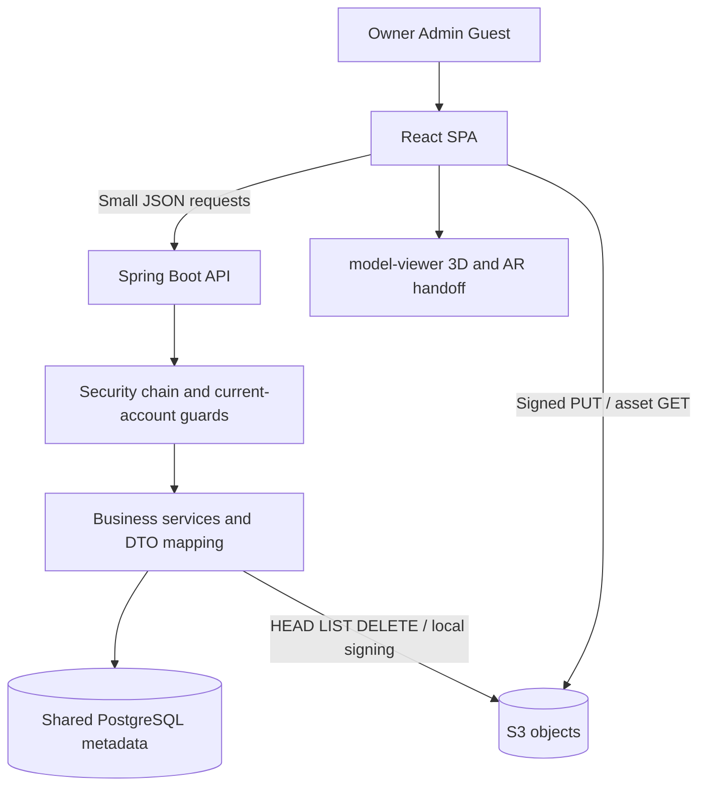

# Atelier AR — master project documentation

**Evidence snapshot:** 2026-10-31. **Product:** Atelier AR, Restaurant AR Menu SaaS. **Git root:** `C:\Users\IQRA COMPUTER\Desktop\atelier-3d-media-engine-v4\atelier-3d-media-engine`. **HEAD:** `330a49c`, plus the existing **uncommitted A01–A03 security changes**. A checkout of that commit alone does not reproduce this snapshot. This documentation request changed documentation only; existing application/test changes were preserved.

This is a source-based handover, not a production certification. Source paths throughout are relative to the Git root unless explicitly absolute. Supporting documents contain exhaustive field/endpoint/index/module inventories; this master explains the product and engineering implications. For current security status, prefer the dated remediation ledger over the preserved historical root audit.

## Documentation map

|Document|Primary use|
|---|---|
|[CODEBASE_ARCHITECTURE.md](CODEBASE_ARCHITECTURE.md)|System/frontend/backend components, workflows, Mermaid architecture/deployment diagrams, complete source and method indexes|
|[API_REFERENCE.md](API_REFERENCE.md)|All 59 application endpoints, access/input/response/handler/service/persistence/consumer details and full DTO field/annotation catalog|
|[DATABASE_DOCUMENTATION.md](DATABASE_DOCUMENTATION.md)|Ten-table dictionary, entity mappings, FK/ER diagram, indexes, all thirteen migrations and PostgreSQL/H2 differences|
|[SECURITY_DOCUMENTATION.md](SECURITY_DOCUMENTATION.md)|Identity/JWT/account gates, tenant isolation, threat model, A01–A19 remediation ledger and PD01 contract defect|
|[DEPLOYMENT_AND_SETUP.md](DEPLOYMENT_AND_SETUP.md)|Exact Windows commands, safe local/test isolation, environment variables, deployment templates, jobs and operational restrictions|
|[FEATURE_INVENTORY.md](FEATURE_INVENTORY.md)|Feature-by-feature frontend/backend/database/dependency implementation and verification matrix|
|[DEVELOPMENT_ROADMAP.md](DEVELOPMENT_ROADMAP.md)|Six proposed phases with priorities, dependencies, modules, acceptance criteria and tests|
|[GLOSSARY.md](GLOSSARY.md)|Repository-specific technical/product terminology and distinctions|

## 1. Executive summary

Atelier AR lets a restaurant publish a branded photo menu with interactive dish models and supported-device AR placement, reached through venue QR codes or direct links. The intended audience, inferred from actual UI copy/workflows, is restaurants/hotels and their platform operator: owners maintain menus; the operator provisions venues and supplies human-assisted model production. Guests need no account or app installation in this web experience.

The value proposition is visual dish discovery, restaurant-specific presentation and manageable model publication without sending large file uploads through the Java server. This is implemented through a React SPA, Spring Boot API, PostgreSQL metadata, direct S3 uploads/delivery, browser image optimization and model-viewer. It is not an implemented ordering/payment system or automated 3D reconstruction service.

Technical maturity is **substantial working implementation with demonstrated automated backend coverage, but incomplete production acceptance**. The complete suite previously passed 374 tests across 29 classes with thirteen H2 migrations, including the approved A01–A03 security regressions. The earlier 208-test baseline is historical, not the current test count. No tests were rerun during this documentation pass. Prior frontend production compilation passed; browser workflows, real PostgreSQL, AWS policies and physical AR devices remain unverified.

Major achievements: clear media metadata/byte separation, tenant-scoped repositories, guest-safe DTO projection, staged replacements, account/version checks across admin/studio, sequence locking, Flyway ownership and a meaningful test suite. Major limitations: OTP failed-attempt rollback/delivery placeholder, conflicting private S3 templates, category ordering and menu-live UI contract defects, analytics races/metric mismatch, incomplete private cleanup, no frontend test/CI/recovery gate, and long-lived browser tokens. There is no evidence of active subscriptions, payments, automatic trial expiry or tenant quota enforcement.

## 2. Product overview and business logic

### SaaS scope and account lifecycle

The multi-tenant product model is real; its commercial billing model is not implemented. One restaurants row combines tenant configuration and owner login. A platform_users row is a separate super-admin identity. There are no employee membership accounts, role-editor UI, self-service registration or public restaurant directory. “Starter/Growth/Scale” bandwidthTier is derived from stored bytes (<1 GiB, <10 GiB, otherwise Scale), not a subscription contract, actual bandwidth metering or enforced entitlement.

RestaurantStatus values are ACTIVE, TRIAL, PENDING, PENDING_ONBOARDING and SUSPENDED. `canUseStudio` allows everything except SUSPENDED; public visibility is only ACTIVE/TRIAL and nondeleted. There is no trial expiration date/job. Soft delete sets deleted_at and suspension/version; restore makes ACTIVE. Hard deletion cascades tenant rows and schedules public cleanup, but private/history/daily-aggregate gaps remain. Admin slug changes alter the guest URL and namespace for future uploads; old QR cards need review and old files are not moved automatically.

### End-to-end journeys

1. **Restaurant onboarding:** visitor opens contact modal and composes mailto or copies demo details; no lead is saved. Platform admin signs in at `/admin`, creates venue with name/slug/owner/email/optional permission/status, receives a generated temporary password once, and delivers it through an out-of-band process. No email onboarding transport is implemented.
2. **Owner first sign-in:** login issues setup-only JWT when must_change_password is true. `/studio` renders LockedStudio/SetPasswordModal. The account replaces its password; backend hashes it, clears setup, increments token version and issues full studio access. Existing old tokens stop working through current-row checks.
3. **Menu creation:** owner chooses flat categories/branding, downsamples a photo, enters dish metadata/tags/price/availability, requests presign, PUTs directly to S3 and confirms. Server stages metadata/sequence first, HEADs object, then marks completed/adjusts usage and evicts menu cache. Abandoned presigns can leave dish-code gaps.
4. **Dish maintenance:** owner edits metadata or availability, replaces photo/model through pending fields while old asset remains live, removes models or deletes dishes. Category assignments are now tenant-validated. Category ordering remains broken by client/DTO field mismatch; category edits lack publication cache eviction.
5. **3D direct path:** only an enabled restaurant can attach/replace GLB/self-contained glTF using the direct model track; cap is 50 MiB by default. ModelPicker shows local inspection/preview, not mesh conversion. Permission is checked again at confirmation.
6. **Concierge path:** owner submits one-to-five guided reference photos for an owned dish into private storage. Issued keys and slots are recorded, confirmation locks dish and creates request/history. Operator views/downloads a browser ZIP photo pack, authors a model outside this application and uploads finished GLB through Admin3dDeskModal. Backend HEAD validates metadata and publishes model/history/counters, superseding older records. No endpoint actually performs photogrammetry, in-production transition or rejection merely because those status constants exist.
7. **Guest discovery:** venue QR points to `/r/{slug}`; page fetches public branding/categories/completed available dishes, groups/searches locally, opens photo/3D sheet and optionally AR or mobile handoff. Guests can contact/social-link the restaurant; no cart/order submission exists. Private-menu API withholds dishes, but UI holding-state detection has PD01 menuLive/isMenuLive mismatch.
8. **Support/reporting:** operator searches/filters/paginates tenants, changes lifecycle/permission/notes, resets owner password or creates audited impersonation. Studio and platform dashboards report stored counters/events. Public events are untrusted engagement signals, not verified sales or billing usage.

### Menu details and customization

Legacy enum categories coexist with tenant custom categories; no hierarchy/subcategories exist. Dietary vocabulary is vegan, vegetarian, halal, gluten-free, dairy-free, nut-free, spicy and chef-pick; backend lowercases/deduplicates into a column string. Tags display on dishes, but guest filtering supports search, chef picks and AR-only, not dietary tag predicates. DAILY_SPECIAL is a merchandising flag without a scheduled expiry.

Branding includes logo/banner, tagline/bio/hours, phone/WhatsApp/social/maps/web links, four theme accents, cards/compact layout and currency code/symbol. Restaurant QR has two visual themes, square PNG export, SVG and physical 4x6/A6 browser print. There is one venue QR rather than persistent table codes. Dish QR handoff is a deep link with dish ID.

## 3. Complete system architecture

The application is a layered monolith, not microservices. Shared database tenancy is enforced by identity extraction, service/account guards and scoped queries; the DB itself is not row-level-security isolated. Scalar-ID entities avoid complex ORM graphs but require deliberate ownership validation. Cloud object permissions constitute a separate trust boundary.

Frontend/backend/media deployment and request/data-flow diagrams are in [architecture sections 1, 5, 6 and 8](CODEBASE_ARCHITECTURE.md). Database ER and logical-vs-enforced relationships are in [database documentation](DATABASE_DOCUMENTATION.md). AWS integration is an SDK adapter and templates, not an infrastructure provisioning system. CloudFront is optional base URL only.

## 4. Frontend technical documentation

React 18.3/Vite 5/Tailwind 3/ES modules use functional components and hooks. App imports four page screens statically and routes through a custom History API store. AuthContext owns separate restored admin/restaurant sessions; page hooks own request loading/errors/forms rather than a shared query-cache library. `api/client.js` centralizes JSON requests, separate bearer tokens, structured field errors, timeout and unauthorized callbacks. `putToS3` is direct XHR for accurate upload progress.

The complete screen/component/API/action matrix and all 61 source files are documented in [architecture frontend sections and source index](CODEBASE_ARCHITECTURE.md). Important reusable controls: ui fields/buttons/Overlay/Spinner, Toast, LuxurySelect, Navbar, PipelineView, PhotoPicker/ModelPicker, ModelStage and QR helpers. UI uses responsive Tailwind breakpoints, safe-area bottom sheets and existing onyx/accent styling; browser accessibility/responsiveness has not been accepted by runtime tests here.

Photo processing progressively downsamples to 1400 pixels by default, uses WebP .82 with JPEG fallback; logo/banner have separate dimensions/quality. Batch max15/workers3 limits browser concurrency. Model inspection supports GLB2/header/JSON and self-contained glTF; external URI resources in glTF are rejected. File checks are client convenience, not security enforcement.

DishSheet preloads model content when opened, supports photo/3D crossfade, custom event progress/errors and AR fallback. ModelStage lazily imports model-viewer, wires custom events with addEventListener and flags imperatively. Caching/reset of the lazy import promise allows subsequent retries. The landing showcase may also mount a model stage; “guest 3D loads on demand” does not establish that the home screen never loads 3D.

Forms have local validation and API field errors, but no automated frontend test/lint script exists. Empty/retry/loading states are present; some background errors (analytics/category preload) are ignored. PD01 private-menu rendering, A06 reorder, absent dietary filter and admin password-change token UX are specific remaining issues, not grounds for a broad redesign.

## 5. Backend technical documentation

Java21/Spring Boot3.3.5 uses constructor injection, validated record DTOs, Lombok entities, domain exceptions, Spring Data repositories, TransactionTemplate and @Transactional. [Architecture module table and method index](CODEBASE_ARCHITECTURE.md) covers every service/config/security/repository file; [API](API_REFERENCE.md) covers controllers/DTOs; [database](DATABASE_DOCUMENTATION.md) covers models and migrations.

The eight controllers are AuthController, AdminAuthController, AdminController, StudioController, MediaController, PublicMenuController, RestaurantController and HealthController. Controllers generally delegate; StudioController.menu-status still directly saves its guarded tenant row. AdminController/StudioController use controller-wide @ModelAttribute current-account guards. Media/dish/branding keep service-level access checks; auth setup operations intentionally use account-level access.

GlobalExceptionHandler maps malformed/validation/domain problems to 400, credential/version failures 401, access/suspension/setup 403, missing resource 404, conflict/integrity/concurrent updates 409, upload verification 422, throttling 429, SDK errors 502 and unconfigured storage 503. Security filters separately render ProblemDetail for unauthenticated/forbidden/audience cases. Generic/unhandled failures are not covered by a universal custom exception policy.

Most media HEAD/DELETE operations are outside short DB transactions; concierge confirmation/approval/cleanup remain exceptions holding connections/locks across network calls. Media optimistic @Version and sequence/confirmation pessimistic locks provide concurrency controls. Restaurant counters update atomically; daily analytics currently does read-modify-write without equivalent protection. Super-admin bootstrap and GET category seeding are real writes and must be considered when starting locally.

Async storage cleanup uses @Async with Boot executor; analytics creates its own virtual-thread executor and ignores futures. StaleUploadReaper runs scheduled fixed-delay jobs; test configuration disables scheduling. Caffeine menu cache is tenant slug scoped; rate/dedup caches are local to process; restaurant token-version cache was removed by A02. No distributed queue/cache/message broker is present.

## 6. Complete API reference

[API_REFERENCE.md](API_REFERENCE.md) enumerates **59 discovered application endpoints**, each with actual HTTP mapping, controller method/source, role/access requirements, exact input declaration, request DTO/body, response DTO, validation/business path, DB interactions and frontend consumer. The full DTO annotation/field catalog allows precise request/response interpretation without invented payloads. Actuator endpoints are described separately from application-owned routes.

Families are `/api/v1/auth`, `/api/v1/auth/admin/login`, `/api/v1/admin`, `/api/v1/studio`, `/api/v1/media`, `/api/v1/public`, legacy `/api/v1/restaurants/{slug}/menu` and `/health`. No public directory/registration, refresh/logout, payment, orders or model-generation endpoint exists. Unsupported routes are default-denied rather than assumed public.

Notable contracts: PageDto exposes items plus content alias; PublicMenuDto's canonical flag is menuLive, not isMenuLive; custom category reorder requires orderedIds; owner/concierge presign workflows have different pending-key contracts; tenant history caps at100 and current admin pipeline at200. A bound isn't complete pagination or an export guarantee. The legacy menu adapter reconstructs the envelope with defaults and loses categories/live state, which requires compatibility review.

## 7. Database documentation

[DATABASE_DOCUMENTATION.md](DATABASE_DOCUMENTATION.md) reconstructs **ten application tables, 150 columns and 27 explicitly named surviving indexes** from numeric V1–V13 PostgreSQL DDL. It also includes the exact persisted JPA fields, table constraints and a migration ledger. Implicit PK/UNIQUE indexes are additional; the count is not a live database measurement. Flyway's own schema history table is framework-managed and not counted as an application entity.

Tables: restaurants, media_details, categories, platform_users, admin_audit_log, password_reset_otps, model_requests, model_request_pending_keys, analytics_events and analytics_daily. Restaurant-owned FKs generally cascade; category delete sets media category null. Analytics daily/audit/logical dish/OTP email references have weaker/no FK relationships. JPA ddl-auto is none; Flyway, not Hibernate, owns schema.

V1 establishes media; V2 tenancy; V3 platform admin/branding/models; V4 provisioning/replacements; V5 categories/concierge/reset/analytics/live switch; V6 request history; V7 dish codes; V8 pending reference keys/active-request uniqueness; V9 OTP attempts/hash width; V10 aggregates/indexes; V11 token versions; V12 sequence; V13 direct-model permission. No applied migration was changed by the security work or this documentation task.

H2 uses PostgreSQL mode but differs in identities/time/backfill syntax/quoted day and partial-index support. Its V8 ordinary index does not reproduce PostgreSQL's unique active-request condition. The successful H2 integration cannot establish production PostgreSQL execution plans, checksum compatibility on an existing DB or all race/constraint behavior. DB access targets and retention/backups were not inspected live.

## 8. AWS and media infrastructure

AwsConfig constructs S3Client/S3Presigner with static credentials when both are configured, otherwise the AWS default provider chain. Credentials/region/bucket are server-side configuration; secrets.properties and environment locations are documented without values. No temporary-session-token static-property pair, emulator endpoint or real credential validation at startup is configured by these beans. Uploads require a configured bucket; signature generation itself is local control-plane work.

Object organization is `restaurant-atelier/{slug}/{segment}/{UUID}.{ext}` for public dish media, separate branding keys and admin `models/twin-*` keys; private references are `restaurant-atelier-private/{slug}/requests/{dishId}/ref-*`. New private keys use a webp extension even though the presign accepts allowed image MIME; server decisions primarily validate metadata. Existing key naming is not a content-conversion service.

PUT URL lifetime is five minutes; signed content type, exact length and cache-control become required metadata. S3Storage removes browser-forbidden signed headers such as host/content-length from script-settable headers; XHR supplies the rest and browser sets length. Confirmation validates ownership/staging and HEAD metadata; bytes do not travel through application upload handlers. Private GET signatures last fifteen minutes when generated for admin/history; publication uses direct public GET or optional configured public-base-url.

Replacement leaves old assets serving until confirmed, then deletes old keys. Cleanup uses scheduled expiry/approved reference removal and async public-prefix sweep. A10 incomplete private/history cleanup and swallowed per-key delete errors mean metadata can claim cleanup without complete deletion. Existing public immutable cache metadata also applies to private references (A13); live/private menu visibility does not revoke published object access.

The checked-in private deny and public-only IAM templates conflict with the intended private flow (A05). API CORS and bucket CORS are independent; bucket CORS must permit real browser origins/PUT/GET/HEAD and expose ETag. No account policy, bucket ACL/public-access-block/encryption/versioning/logging/lifecycle rule was inspected live; none should be inferred from these templates. No CloudFront distribution/OAC/cache invalidation is provisioned.

Cost dimensions are S3 stored bytes, PUT/HEAD/GET/LIST/DELETE requests, public model/image transfer, hosting/database resources and any chosen CDN/provider. Direct uploads reduce API memory/transfer pressure but do not remove S3 or guest egress costs. There is no aggregate tenant quota or billing enforcement. No current vendor price/free-tier availability is asserted by this local code report.

## 9. 3D, AR and media engine

The implemented engine is upload/metadata/lazy viewing/AR handoff. It does not produce real-world scans. Owners with permission can upload GLB or self-contained glTF; admin UI accepts GLB, while admin service MIME rules also admit glTF JSON/octet-stream and names the final key .glb. Validate actual authored formats rather than interpreting allowed MIME as conversion. Default direct cap is50MiB; admin published cap25MiB; admin UI's15MB recommendation is advice, not the backend cap.

inspectModel verifies GLB signature/version/JSON boundaries, estimates geometry stats and detects declared compression extensions; it rejects external resources for .gltf. It does not fully validate geometry/accessor ranges, transcode textures, generate LODs, bake scale or run malware scans. `scripts/generate-showcase-glb.mjs` generates illustrative bundled geometry, not customer reconstruction.

ModelStage requests webxr/scene-viewer/quick-look, horizontal floor placement and fixed table/auto floor scaling. Actual physical dimensions depend on authored coordinates; table-accurate size isn't established by a flag alone. Desktop guests have interactive WebGL and mobile QR fallback; mobile AR depends on device/browser/OS/HTTPS/model support and hosting permission policy. No device compatibility matrix was executed. There is no separately stored USDZ field or native app; any platform adaptation belongs to model-viewer/runtime support and remains unverified here.

## 10. Authentication and security

[SECURITY_DOCUMENTATION.md](SECURITY_DOCUMENTATION.md) is the full current ledger/threat model. JWTs use HS256 issuer/time/audience/roles plus current-account/version checks; passwords BCrypt; studio identity comes from rid/slug claims; admin uses aid. Guests receive sanitized DTOs. Public metadata can legitimately expose restaurant ID/branding/contact; private account/email/audit/CRM fields are not public restaurant projections.

A01 admin current validation, A02 studio current validation and A03 tenant category validation are remediated in the working tree, backed by prior signed-token/unit regressions. This does not mean all findings are fixed: OTP lockout transaction semantics and logging-only delivery, private S3 template denial, long token/storage/bootstrap lifecycle, upload guarantees/private caching, proxy/rate multi-instance limits and cleanup remain. A11/A14/A15 have explicitly partial remediation status because their old bypass/cache/test evidence changed while other aspects persist.

There is no authorization certification, full Git-history secret clearance, live bucket audit or external penetration test. No secret values are reproduced. Safest next security task is transaction-safe OTP attempts/consumption while reset stays disabled; template repairs require separate nonproduction cloud verification. No new critical finding was established after A01; absence of a found critical issue is not proof that none exists.

## 11. Integrations and external dependencies

The repository's direct declared dependency list is appended below. Versions without explicit pins are controlled by Spring Boot parent/BOM or npm semver/lockfile; no vulnerability/compatibility update assessment was performed in this pass.

|Integration/library group|Purpose and source|Configuration/runtime need|Failure/cost impact and verification|
|---|---|---|---|
|AWS S3 + SDK/presigner|S3Storage/AwsConfig; object metadata, direct signed upload/download|Server AWS provider chain/static pair, bucket/region; network for HEAD/DELETE/guest bytes|Media unavailable or unpublishable; storage/request/transfer costs; source/mocks/local signing only|
|PostgreSQL JDBC/Hikari/JPA|Repositories/entities and datasource config|Running PostgreSQL for deployed data; connection credentials|Metadata/login/API unavailable on DB failure; provisioned DB cost; H2 tests do not verify live PG|
|H2|Embedded local/test DB and vendor migration tree|Runtime classpath; no external DB for in-memory tests|Disposable test data, vendor differences; prior migrations/concurrency passed|
|Spring Web/Validation/Security/OAuth2/Nimbus|HTTP/Jakarta DTO/BCrypt/JWT enforcement|Server runtime and JWT key|API/auth correctness; no external identity-provider cost; tests passed within stated scope|
|Flyway|Schema migration at startup|DB permissions/history/location|Startup/schema risk; no standalone managed migration service; H2 V1–V13 verified previously|
|Caffeine|Menu/login/analytics process caches|In-JVM runtime|Stale publication/rate coordination across nodes; no external cache bill; source/tests|
|model-viewer / bundled three.js|ModelStage/lazy loader/landing and guest 3D|Browser WebGL/AR APIs, asset fetch; decoder resources may depend on runtime formats|Device/render failure; download cost; library compiled, actual AR unverified|
|React/ReactDOM/Vite/plugin|SPA rendering/build/dev proxy|Node build, static JS runtime|Build/load correctness; no hosted React service; prior production build passed|
|Tailwind/PostCSS/Autoprefixer|Utility CSS design/build|Build-time compiler; browser CSS output|Style regressions; no external CSS service; visual QA pending|
|qrcode|qrCard/ArHandoff matrix/export|Browser/Node JS|QR generation unavailable if module fails; isolated matrix generation passed|
|JSZip|Admin3dDeskModal reference photo pack|Browser fetch of private signed photos and ZIP memory|Failed/expired private fetch or memory pressure; no backend ZIP service; source/build only|
|lucide-react|Icon components|Bundled browser runtime|Presentation only; source/build|
|Google Fonts|index.html/qrCard font embedding|Browser network to fonts.googleapis.com/fonts.gstatic.com|Typography/export fallback if blocked; external service availability/privacy considerations; no account API|
|Render/Vercel|Declared backend/DB and SPA hosting|Deployment account settings/env/regions/origins|Hosting quotas/prices may change; no live deployment inspection|
|Browser mailto/WhatsApp/social/maps|ContactModal/SocialBar links|User application/platform access|Contact navigation failure; not a server-integrated CRM/email/maps API|
|JUnit/Mockito/AssertJ/MockMvc/Surefire/Byte Buddy|Backend unit/MVC/security/integration tests|Test-only; Windows agent permission can matter|Tests unavailable/stalled under restrictions; prior suite passed after authorized execution|
|Lombok/configuration processor/Maven plugins|Compile-time generation/build/package|JDK/Maven build tooling|Build failure if unavailable; no production external service|

CSP allowlisted decoder/CDN hosts are not proof of a separately configured third-party account integration. No email transport, payment processor, model-generation provider, analytics SaaS, Redis/message broker or monitoring vendor was found.

## 12. Deployment and DevOps

Use [DEPLOYMENT_AND_SETUP.md](DEPLOYMENT_AND_SETUP.md) for exact prerequisites, Windows directory commands, safe disposable H2 overrides, local PostgreSQL target checks, Maven/npm commands, environment variable inventory, hosting templates and troubleshooting. The documentation task did not start an application or deploy resources.

Default prod, optional secrets imports and cloud DATABASE_URL adaptation demand explicit target checking. Local profile uses development defaults and can reset admin password; local+h2 file DB is not automatically disposable. Flyway and bootstrap write on startup, and scheduled reaper can delete S3 objects. Never use startup/cleanup commands against production as an audit check.

Dockerfiles build Maven/Java21 images with skipped tests, nonroot runtime and health check/JVM flags. render.yaml declares backend Docker and managed PG wiring; Vercel root/frontend configs duplicate rewrite/security policy. No checked-in CI workflow, backup automation, deployment transaction, central monitoring/alerting or current hosting state is established. Release work needs test gates, secret review, backup/restore and forward-compatible migrations; an image rollback does not undo schema migrations.

## 13. Testing and quality assurance

|Evidence|Confirmed result|Interpretation|
|---|---|---|
|Historical pre-fix log `backend/target/audit-mvn-test-rerun.log`|208 passed, zero failures/errors/skipped, 27 classes, thirteen H2 migrations,1:06|Confirms requested historical context; not latest count|
|Post-fix log `backend/target/security-fixes-mvn-test.log` and 29 Surefire XML reports|374 passed, zero failures/errors/skipped, thirteen H2 migrations,1:56|Current prior executed backend baseline; includes 166 new security/isolation executions|
|Prior frontend production build|Vite5.4.21,1809 modules,13.12s; split model-viewer chunk|Compilation/bundling only, not UI or API acceptance|
|Prior isolated Node assertions|Nonempty QR matrix and three media helper assertions|Limited deterministic helper scope, not QR export/scan/browser processing|
|Documentation pass checks|Source/config/migration/DTO inventories, report reconciliation, link/structure/content checks|No application/test/live integration rerun|

Existing tests cover configuration/profile parsing, password/JWT/audiences, throttle/IP resolver, HTTP security headers, admin/studio/auth/media/legacy/health controllers, auth/admin/branding/dish/media/replacement/concierge/OTP/analytics/public menu policies and slug normalization. ServiceHarness uses mock repositories/transaction manager/S3 with real local presigner; it cannot establish actual transaction rollback or live AWS permission behavior. DishSequenceConcurrencyTest uses a real H2 application context/DB, thirteen migrations and fifteen allocations; it does not substitute for PostgreSQL concurrency.

AccountAccessSecurityTest discovers every mapped admin/studio operation and uses signed bearer tokens through the real chain/current-account services with mocked persistence/delegates. CategoryIsolationTest validates scoped queries, rejection-before-save/signing and no foreign response name; it does not inspect a production schema or migrate legacy invalid rows. No line/branch coverage tool/report is configured, so 374 tests is not a coverage percentage. Full per-class counts are appended below.

Missing quality gates: frontend behavioral/visual/accessibility suite, disposable PostgreSQL migrations/races, real OTP rollback/consume behavior, nonproduction S3 policy/cleanup/replay/caching, end-to-end browser user journeys and AR device matrix. Existing passed tests can coexist with source-established A04/A06/PD01 defects because those paths are not verified end to end.

## 14. Performance and scalability

Frontend prior output: main JS579.61kB (gzip161.62kB), model-viewer1072.76kB (gzip300.17kB), CSS63.69kB (gzip11.91kB), auxiliary browser chunk24.53kB. Page imports remain static and 3D is large despite lazy library loading; warning threshold1600kB is not a performance budget. Browser Canvas/ZIP/model decoding can still use substantial memory. No mobile timing, FPS, heap or lighthouse benchmark was executed.

Backend avoids binary heap buffering, uses Java21 virtual threads and bounded JDBC pool defaults10/local5. Virtual threads do not make DB connections unlimited. Concierge AWS calls spanning transactions/locks can exhaust the pool; analytics per-task executor has no global backpressure/durable delivery or explicit shutdown handling. Docker heap/metaspace limits do not guarantee a total512MB RSS footprint.

Database hot menu queries and histories have tenant/status/order indexes; pages bounded and batch decorations reduce classic N+1. No production EXPLAIN/counter contention study exists. Atomic usage arithmetic contrasts with non-atomic daily aggregates. Events/OTPs/private files lack complete retention coverage and daily aggregate orphans can accumulate.

Caffeine is instance-local: menu mutation doesn't evict other nodes, category edits don't even evict the local menu, throttles/dedup budgets multiply across nodes. Current restaurant version checks are fresh per request after A02. Public menu HTTP freshness15s/stale60s layers over server ten-minute cache; asset cache is year-long immutable even on private references. Exact cross-node/publication staleness and privacy semantics require explicit acceptance criteria.

S3 direct transfer scales independently of API byte throughput but increases request/egress and client-memory concerns. Optimize with measured asset budgets/retention/cache policy before adding services or changing frameworks. CloudFront remains a conditional decision, not an implemented optimization. See roadmap R14–R17 for measurable acceptance rather than speculative infrastructure additions.

## 15. Existing technical audit findings

[Security ledger section8](SECURITY_DOCUMENTATION.md#8-audit-finding-validation-and-remediation-ledger) validates **every A01–A19 finding** with severity, source, root cause/impact, verification, current status and recommended next work. It explicitly records A01–A03 remediated, A11/A14/A15 partially improved, A18 runtime-unverified and the remaining issues open. PD01 adds the independently confirmed privacy-presentation contract mismatch. No issue was silently marked resolved and the historical audit was not overwritten.

## 16. Complete feature inventory

[FEATURE_INVENTORY.md](FEATURE_INVENTORY.md) contains the cross-layer matrix for product capabilities, screens, storage/3D/AR, accounts, QR, analytics, status/commercial controls, tests/deployment and absent features. Each row includes frontend/backend/database/external dependency/status/evidence/remaining work. “Implemented” is not synonymous with runtime verified; mailto contact is intentionally frontend behavior, logging email is a mocked delivery substitute, and commercial plans are absent rather than assumed future commitments.

## 17. Known issues and technical debt

|Category|Highest-impact current items|Priority implication|
|---|---|---|
|Critical security|Historical A01 is remediated; no new unresolved critical established by this source pass|Preserve signed-token regression gate; no blanket security certification|
|High security|A04 OTP persistence/consumption; A05 private S3 policy templates|Fix before enabling reset/private concierge production acceptance|
|High functional|PD01 private menu holding state; A06 category reordering|Small source contract fixes with focused tests before new UI features|
|Data integrity/lifecycle|A07 duplicate/seeding/category cache, A08 daily races, A10 cleanup/aggregate orphans|Use real transaction/concurrency tests and truthful retry outcomes|
|Performance|A09 network-held locks/pool, A15 local coordination, A17 bundles; raw retention|Measure representative workload and keep short transaction boundaries|
|UX/UI|Password-change session response, absent dietary filters vs docs, AR/export browser uncertainty|Preserve design; target specific observed defects and acceptance gaps|
|Infrastructure|Conflicting policy examples, optional CDN only, duplicate Docker/Vercel definitions, backups unverified|Do not apply templates unchanged or infer operational readiness|
|Testing|No frontend/PG/AWS/device/CI gate; OTP tests mock away rollback|Prioritize tests that expose real failure modes|
|Documentation|Root historical baseline, TTL/migration/route/feature claims drift|Use dated current ledger; reconcile entry points when approved|

## 18. Development roadmap

[DEVELOPMENT_ROADMAP.md](DEVELOPMENT_ROADMAP.md) defines six phases: (1) security/stability, (2) core completion, (3) targeted UX/design validation, (4) performance/scalability, (5) SaaS operational readiness, (6) conditional product discovery. Every task lists objective/dependencies/modules/acceptance/tests/priority. Proposed work is not executed or approved just because it appears there.

Immediate recommendation: transaction-safe OTP failure/consume handling with real DB regressions, while reset remains disabled. Separately review nonproduction S3 permissions. Then fix A06/PD01 contracts and category publication, followed by analytics/cleanup/transaction reliability and realistic acceptance gates. No stack replacement, rebuild, UI redesign or invented billing/ordering/model-reconstruction implementation is proposed.

## 19. Developer onboarding guide

1. Locate the nested Git root, inspect existing diffs and read this master/security ledger plus AGENTS. Preserve existing uncommitted A01–A03 changes; do not reset/clean or assume HEAD equals this snapshot.
2. Confirm Java21/Maven3.9+ and Node>=18.18. No Maven wrapper exists. Resolve inherited Windows process environment if the toolchain isn't visible.
3. Read configuration/import/target safety rules. Choose in-memory H2 first for disposable onboarding or an explicitly owned disposable PostgreSQL database. Do not start with the default prod target or presumed-safe local file DB.
4. Run existing `mvn test` from backend only after target checks; inspect Surefire. Use the safe local process-only launcher in deployment guide if an interactive API is desired. Startup writes schema/bootstrap data; ordinary audits should not start it against existing services.
5. Run `npm ci` then `npm run dev` from frontend in a second terminal; use Vite's `/api` proxy. Build/preview commands are documented separately. Never put AWS credentials/JWT secret in VITE variables.
6. Find HTTP/DTOs in web/dto, business logic in service, SQL ownership/indexes in migration/repository, and UI actions in matching pages/components/api helpers. Use the API/DB/source indexes rather than guessing endpoints/table names.
7. For future changes, add targeted regressions for actual behavior, use real transactions when commit/rollback is the requirement, run the complete backend suite and frontend checks appropriate to the change. No existing frontend test/lint command should be invented.
8. Use Git scoped diffs and diff-check; preserve user work/ignored secrets; don't stage all, commit/push/deploy/mutate schema without task authorization. Diagnose known contract/config defects using the troubleshooting matrix before changing unrelated modules.

Exact copyable PowerShell commands and separate test/H2/PostgreSQL/hosting safety procedures are in [DEPLOYMENT_AND_SETUP.md](DEPLOYMENT_AND_SETUP.md). This guide documents them; it did not execute an application startup or cloud operation.

## 20. Final architecture assessment

|Dimension|Assessment|
|---|---|
|Architecture quality|Practical layered modular monolith; good direct-media boundary; no need for technology replacement to address current issues|
|Maintainability|Readable domain services/DTOs and reusable UI; large concierge/admin/page files, compatibility constructors and duplicate deployment configs add debt|
|Security maturity|Improved materially by current-account/version and category fixes with signed-token tests; reset/cloud/session/upload lifecycle remains incomplete|
|Database design|Useful tenant/menu indexes, Flyway ownership and concurrency controls; scalar relationships require discipline; aggregate integrity/retention and vendor equivalence need work|
|Frontend quality|Substantial responsive component system and integrated actions; no behavioral suite and specific wire-contract defects remain; design quality not visually certified|
|Backend quality|Meaningful service/security/MVC coverage and successful H2 baseline; mocks leave transactional and external-service semantics under-tested|
|SaaS readiness|Tenant provisioning/access/branding and operator support exist; commercial billing/quotas/trial automation and recovery gates do not|
|Production readiness|Not established; no live PostgreSQL/AWS/hosting/device acceptance or recovery verification in this investigation|

Top ten next actions, in order: (1) fix/test OTP transaction semantics; (2) review/test private S3 templates nonproduction; (3) align menu-live contract; (4) fix category reorder; (5) add category cache/concurrency consistency; (6) make analytics writes/metrics reliable; (7) make private cleanup truthful/retryable; (8) remove AWS network from concierge transactions with safe revalidation; (9) complete password/bootstrap session lifecycle; (10) establish PostgreSQL/browser/AR/release/restore acceptance gates. Detailed dependencies and priorities are in the roadmap.

### Investigation coverage and limits

Inspected Git root/status, application source/configuration, frontend package/lock/build settings/assets inventory, all controller mappings/DTO declarations, entity mappings, both migration histories, services/repositories/security/jobs, tests and retained results, Docker/Render/Vercel/IAM/CORS templates, and existing documentation. Source-derived indexes/dictionaries are generated from actual files and checked for coverage. Generated/dependency binary contents were not exhaustively audited; third-party transitive source/security advisories were not a supply-chain certification. Bundled GLB media was inventoried and its generator reviewed, not rendered/decoded on a physical device.

Deliberately excluded: credential contents, full Git secret history, production DB/data/query plans, live cloud policies/accounts/hosting state, actual email delivery, native-device AR and real browser accessibility/performance. No production service was connected to. Prior test/build results were confirmed from retained evidence, not rerun. Unknowns remain labelled rather than inferred from UI/docs. The only files created/changed by this pass are the nine documentation outputs.

## Appendix A. Exact retained Surefire class results

These are read from the existing post-remediation XML reports; reading reports does not rerun tests. The original historical 27-class/208-run baseline is separately confirmed by the retained earlier log. Parameterized executions count separately.

|Class|Tests|Failures|Errors|Skipped|Source|
|---|---|---|---|---|---|
|com.atelier.media.config.DatabaseUrlEnvironmentPostProcessorTest|4|0|0|0|[test source](../backend/src/test/java/com/atelier/media/config/DatabaseUrlEnvironmentPostProcessorTest.java)|
|com.atelier.media.config.StartupProfileValidatorTest|8|0|0|0|[test source](../backend/src/test/java/com/atelier/media/config/StartupProfileValidatorTest.java)|
|com.atelier.media.security.AccountAccessSecurityTest|159|0|0|0|[test source](../backend/src/test/java/com/atelier/media/security/AccountAccessSecurityTest.java)|
|com.atelier.media.security.CaffeineLoginThrottleTest|4|0|0|0|[test source](../backend/src/test/java/com/atelier/media/security/CaffeineLoginThrottleTest.java)|
|com.atelier.media.security.ClientIpResolverTest|3|0|0|0|[test source](../backend/src/test/java/com/atelier/media/security/ClientIpResolverTest.java)|
|com.atelier.media.security.PasswordHashingTest|4|0|0|0|[test source](../backend/src/test/java/com/atelier/media/security/PasswordHashingTest.java)|
|com.atelier.media.security.SecurityHeadersTest|1|0|0|0|[test source](../backend/src/test/java/com/atelier/media/security/SecurityHeadersTest.java)|
|com.atelier.media.security.TokenSecurityTest|4|0|0|0|[test source](../backend/src/test/java/com/atelier/media/security/TokenSecurityTest.java)|
|com.atelier.media.security.TokenServiceTest|11|0|0|0|[test source](../backend/src/test/java/com/atelier/media/security/TokenServiceTest.java)|
|com.atelier.media.service.AdminServiceTest|13|0|0|0|[test source](../backend/src/test/java/com/atelier/media/service/AdminServiceTest.java)|
|com.atelier.media.service.AnalyticsServiceTest|5|0|0|0|[test source](../backend/src/test/java/com/atelier/media/service/AnalyticsServiceTest.java)|
|com.atelier.media.service.AuthServiceTest|11|0|0|0|[test source](../backend/src/test/java/com/atelier/media/service/AuthServiceTest.java)|
|com.atelier.media.service.BrandingServiceTest|8|0|0|0|[test source](../backend/src/test/java/com/atelier/media/service/BrandingServiceTest.java)|
|com.atelier.media.service.CategoryIsolationTest|7|0|0|0|[test source](../backend/src/test/java/com/atelier/media/service/CategoryIsolationTest.java)|
|com.atelier.media.service.DishSequenceConcurrencyTest|1|0|0|0|[test source](../backend/src/test/java/com/atelier/media/service/DishSequenceConcurrencyTest.java)|
|com.atelier.media.service.DishServiceTest|11|0|0|0|[test source](../backend/src/test/java/com/atelier/media/service/DishServiceTest.java)|
|com.atelier.media.service.MediaReplacementServiceTest|12|0|0|0|[test source](../backend/src/test/java/com/atelier/media/service/MediaReplacementServiceTest.java)|
|com.atelier.media.service.MediaServiceTest|10|0|0|0|[test source](../backend/src/test/java/com/atelier/media/service/MediaServiceTest.java)|
|com.atelier.media.service.ModelRequestServiceTest|16|0|0|0|[test source](../backend/src/test/java/com/atelier/media/service/ModelRequestServiceTest.java)|
|com.atelier.media.service.OtpServiceTest|5|0|0|0|[test source](../backend/src/test/java/com/atelier/media/service/OtpServiceTest.java)|
|com.atelier.media.service.PublicMenuServiceTest|2|0|0|0|[test source](../backend/src/test/java/com/atelier/media/service/PublicMenuServiceTest.java)|
|com.atelier.media.service.SlugPolicyTest|3|0|0|0|[test source](../backend/src/test/java/com/atelier/media/service/SlugPolicyTest.java)|
|com.atelier.media.service.SuperAdminBootstrapTest|3|0|0|0|[test source](../backend/src/test/java/com/atelier/media/service/SuperAdminBootstrapTest.java)|
|com.atelier.media.web.AdminControllerTest|17|0|0|0|[test source](../backend/src/test/java/com/atelier/media/web/AdminControllerTest.java)|
|com.atelier.media.web.AuthControllerTest|14|0|0|0|[test source](../backend/src/test/java/com/atelier/media/web/AuthControllerTest.java)|
|com.atelier.media.web.HealthControllerTest|4|0|0|0|[test source](../backend/src/test/java/com/atelier/media/web/HealthControllerTest.java)|
|com.atelier.media.web.MediaControllerTest|13|0|0|0|[test source](../backend/src/test/java/com/atelier/media/web/MediaControllerTest.java)|
|com.atelier.media.web.RestaurantControllerTest|9|0|0|0|[test source](../backend/src/test/java/com/atelier/media/web/RestaurantControllerTest.java)|
|com.atelier.media.web.StudioControllerTest|12|0|0|0|[test source](../backend/src/test/java/com/atelier/media/web/StudioControllerTest.java)|
|**Total**|**374**|**0**|**0**|**0**|29 classes|

No jacoco/line-coverage percentage or load/latency SLA is supplied by these reports. AccountAccessSecurityTest uses real signed token validation and account gates with mocked repositories; CategoryIsolationTest uses mocked persistence/local presigning; DishSequenceConcurrencyTest is the real H2 context/transaction integration.

## Appendix B. Direct dependency declarations

This is the declared project surface, not a full transitive SBOM, license review or current advisory scan. Maven parent is Spring Boot3.3.5; AWS BOM property2.28.29; Java21. Resolved npm versions below are read from the existing lockfile, not installed/updated in this pass.

### npm

|Package|Scope|package.json range|Lockfile resolved version|
|---|---|---|---|
|@google/model-viewer|dependencies|`^4.0.0`|4.4.0|
|jszip|dependencies|`^3.10.2`|3.10.2|
|lucide-react|dependencies|`^0.453.0`|0.453.0|
|qrcode|dependencies|`^1.5.4`|1.5.4|
|react|dependencies|`^18.3.1`|18.3.1|
|react-dom|dependencies|`^18.3.1`|18.3.1|
|@vitejs/plugin-react|devDependencies|`^4.3.3`|4.7.0|
|autoprefixer|devDependencies|`^10.4.20`|10.6.1|
|postcss|devDependencies|`^8.4.47`|8.5.31|
|tailwindcss|devDependencies|`^3.4.14`|3.4.19|
|vite|devDependencies|`^5.4.10`|5.4.21|

### Maven

|Dependency|Explicit version declaration|Scope|
|---|---|---|
|software.amazon.awssdk:bom|${aws.sdk.version}|import|
|org.springframework.boot:spring-boot-starter-web|Inherited from parent/dependency management|compile/default|
|org.springframework.boot:spring-boot-starter-data-jpa|Inherited from parent/dependency management|compile/default|
|org.springframework.boot:spring-boot-starter-validation|Inherited from parent/dependency management|compile/default|
|org.springframework.boot:spring-boot-starter-cache|Inherited from parent/dependency management|compile/default|
|org.springframework.boot:spring-boot-starter-actuator|Inherited from parent/dependency management|compile/default|
|org.springframework.boot:spring-boot-starter-security|Inherited from parent/dependency management|compile/default|
|org.springframework.boot:spring-boot-starter-oauth2-resource-server|Inherited from parent/dependency management|compile/default|
|com.github.ben-manes.caffeine:caffeine|Inherited from parent/dependency management|compile/default|
|org.flywaydb:flyway-core|Inherited from parent/dependency management|compile/default|
|org.flywaydb:flyway-database-postgresql|Inherited from parent/dependency management|compile/default|
|org.postgresql:postgresql|Inherited from parent/dependency management|runtime|
|com.h2database:h2|Inherited from parent/dependency management|runtime|
|software.amazon.awssdk:s3|Inherited from parent/dependency management|compile/default|
|org.projectlombok:lombok|Inherited from parent/dependency management|compile/default|
|org.springframework.boot:spring-boot-configuration-processor|Inherited from parent/dependency management|compile/default|
|org.springframework.boot:spring-boot-starter-test|Inherited from parent/dependency management|test|
|org.springframework.security:spring-security-test|Inherited from parent/dependency management|test|

Annotation processors explicitly include Lombok and Spring configuration processor; build plugins are Maven Compiler and Spring Boot Maven Plugin plus parent-provided test/resource defaults. AWS BOM is dependency management, not an independently deployed runtime service.
